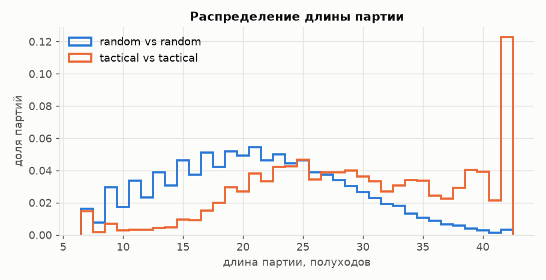
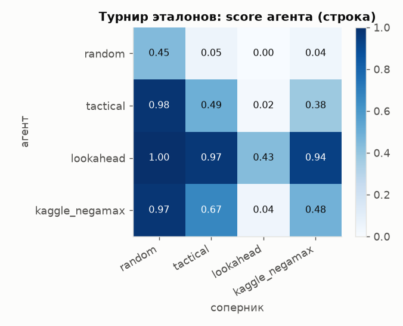
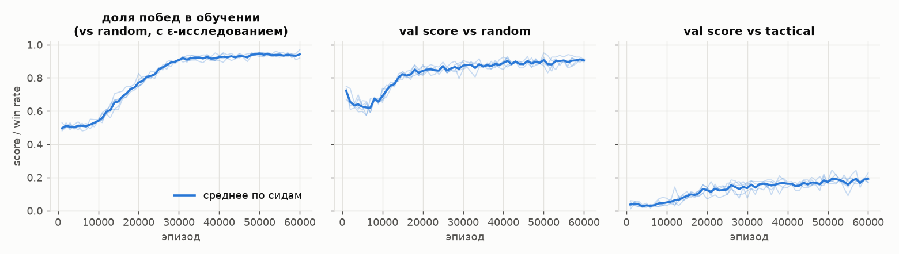
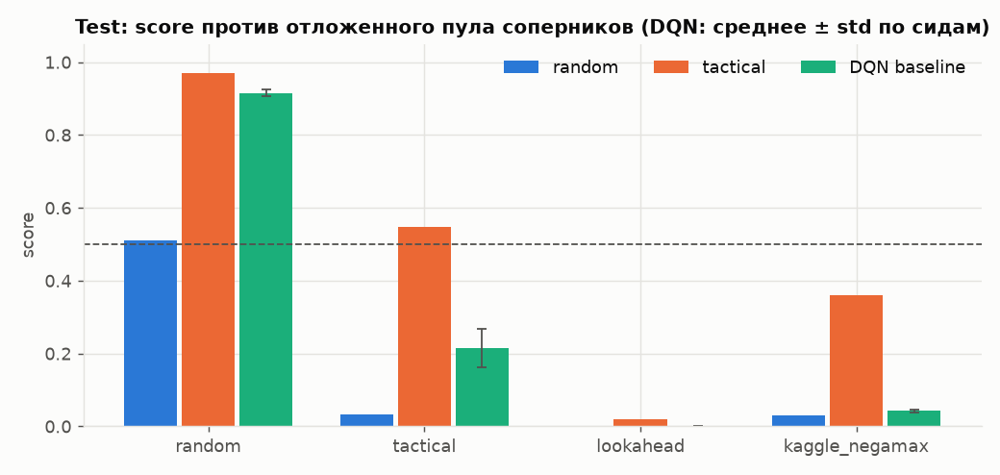
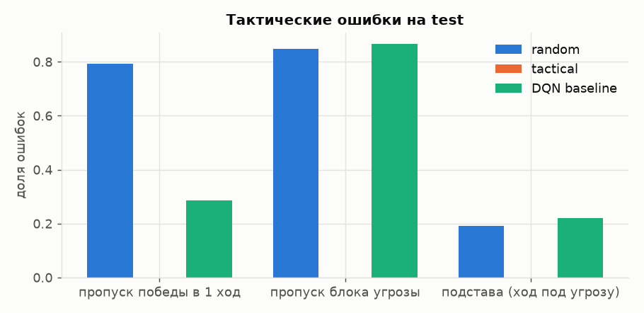

# ConnectX: воспроизводимый DQN baseline для «Четыре в ряд»

Домашнее задание 1 по ML R&D: постановка задачи, baseline, локальная оценка и воспроизводимый репозиторий. Задача — [Kaggle ConnectX](https://www.kaggle.com/competitions/connectx), поле 6×7, четыре фишки в ряд.

**Результат:** Double DQN с MLP, обученный только против случайного соперника, получил **test macro score 0,293 ± 0,015** по пяти сидам. Случайный агент на том же протоколе — **0,143**, тактическая эвристика — **0,474**. Модель научилась использовать ошибки random, но часто не защищается: пропускает **86,6%** учитываемых возможностей заблокировать угрозу. Чекпойнты выбирались по отдельной validation-оценке. Все числа ниже — локальные результаты; Kaggle-рейтинг для этого сабмишена не измерялся.

Основные артефакты: [отчёт](results/baseline_dqn/report.md), [машиночитаемая сводка](results/baseline_dqn/summary.json), [конфиг](configs/baseline.yaml), [готовый сабмишен](submission/main.py) и [его проверка](submission/main.validation.json).

**Навигация:** [0. Запуск](#0-запуск-и-проверка) · [1. Постановка и гипотеза](#1-постановка-задачи-и-гипотеза) · [2. Формализация](#2-формализация-что-является-x-и-y) · [3. EDA](#3-данные-и-eda) · [4. Baseline](#4-baseline-и-зафиксированные-настройки) · [5. Протокол оценки](#5-протокол-оценки-и-защита-от-утечек) · [6. Результаты](#6-результаты-baseline) · [7. Исследовательские вопросы](#7-исследовательские-вопросы) · [8. Выводы](#8-выводы-и-ограничения) · [9. Обязательные вопросы](#9-ответы-на-пять-обязательных-вопросов) · [10. Источники](#10-источники-и-вклад-реализации)

## 0. Запуск и проверка

Проверено на **Python 3.11, macOS Apple Silicon, CPU**. Пакеты зафиксированы в [requirements.txt](requirements.txt); окружение исходного обучения записано в `runs/baseline_dqn/seed*/train_summary.json`. Нужны Python ≥3.11 и несколько гигабайт свободной памяти. GPU, датасет с Kaggle и Kaggle API token для локального запуска не требуются.

Все команды выполняются из корня `connectx-rl/`:

```bash
uv venv --python 3.11 .venv
uv pip install --python .venv/bin/python -r requirements.txt
export PYTHONPATH=src

# Проверка движка, метрик, модели и оркестрации.
.venv/bin/python -m pytest -q tests

# Полный короткий прогон в отдельной папке smoke_<timestamp>.
SMOKE=1 bash scripts/run_baseline.sh

# Воспроизведение основного эксперимента в новой папке, сохраняя исходные результаты.
bash scripts/run_baseline.sh configs/baseline.yaml --experiment baseline_reproduction
```

Без `uv`: `python3.11 -m venv .venv`, затем `.venv/bin/python -m pip install -r requirements.txt`.

Полный запуск выполняет тесты → EDA → обучение пяти сидов → оценку эталонов и моделей → отчёт и графики → экспорт сабмишена и проверку в официальной среде. Исходное обучение заняло **633–668 секунд на сид** при пяти параллельных процессах по одному потоку; полный прогон — около 20 минут на использованном компьютере. На другом CPU время может существенно отличаться. Smoke использует два сида, 1000 эпизодов на сид и уменьшенные EDA/eval-выборки; его метрики не являются результатом baseline. Smoke проходит целиком примерно за **1,5 минуты** (`WORKERS=4`, тот же компьютер).

Что уже проверено на сохранённых артефактах: 246 тестов проходят; `connectx_rl.report` пересобирает `summary.json` и все графики байт-в-байт из сохранённых партий; повторный экспорт `seed0/best.pt` даёт `submission/main.py` с тем же SHA-256 (`b31c154d…`), совпадение ходов с локальным агентом 100% на 213 позициях, 16 партий в официальной `kaggle_environments` без ошибок ([main.validation.json](submission/main.validation.json)). Тест `test_short_training_is_reproducible_and_refuses_overwrite` проверяет, что обучение с одним seed даёт идентичные веса.

Скрипт отказывается перезаписывать существующий эксперимент. Для нового полного запуска укажите новое `--experiment NAME`; smoke по умолчанию получает уникальное имя. `WORKERS=4` задаёт число процессов оценки. `--reuse-trained` разрешает использовать уже обученные модели после проверки конфигов и завершённости обучения, если итоговая папка результатов ещё не создана.

Быстрая проверка сохранённых результатов без обучения:

```bash
export PYTHONPATH=src
.venv/bin/python -m connectx_rl.report --config configs/baseline.yaml

# Переоценка сохранённой модели: отдельный файл, исходные результаты сохраняются.
.venv/bin/python -m connectx_rl.evaluate --config configs/baseline.yaml \
  --split test --agent dqn:runs/baseline_dqn/seed0/best.pt \
  --workers 4 --out results/check_seed0.json

# Экспорт и проверка без изменения основного submission/main.py.
.venv/bin/python -m connectx_rl.export_submission \
  --ckpt runs/baseline_dqn/seed0/best.pt --out results/check_submission/main.py
```

Для отдельного обучения с изменёнными параметрами используйте новую папку:

```bash
PYTHONPATH=src .venv/bin/python -m connectx_rl.train \
  --config configs/baseline.yaml --seed 0 --out runs/exploration/seed0 \
  --set train.gamma=0.99 'model.hidden=[128]'
```

`--set` относится к модулю `train`. Подобные прогоны нужно хранить отдельно и не включать в исходную сводку.

### Структура и сохранённые артефакты

```text
connectx-rl/
├── README.md
├── requirements.txt, pyproject.toml
├── configs/baseline.yaml
├── scripts/run_baseline.sh
├── src/connectx_rl/
│   ├── board.py                  # битборд-движок и представление позиции
│   ├── agents.py                 # random, tactical, lookahead, адаптер Kaggle
│   ├── model.py, train.py        # MLP, Double DQN, чекпойнты
│   ├── evaluate.py, report.py    # партии, метрики, статистика и отчёт
│   ├── eda.py, plotting.py       # свойства среды и визуализации
│   └── export_submission.py     # самостоятельный numpy-агент
├── tests/
├── runs/baseline_dqn/seed*/      # best.pt, last.pt, config/history/train_summary.json
├── results/
│   ├── eda/                     # исходный EDA и графики
│   ├── reference/               # исходные test-партии эталонов
│   ├── baseline_dqn/            # 15 оценок моделей, report, summary, figures
│   └── dev/                     # журнал предварительных проб и обзор источников
└── submission/main.py            # исходный экспорт из seed0/best.pt
```

Новые полные и smoke-запуски сохраняют свои EDA, эталоны и сабмишен в `results/<experiment>/{eda,reference,submission}/`, а эффективный конфиг и сведения о ходе запуска — в `runs/<experiment>/`. Исходные артефакты оставлены на прежних путях для проверяемости уже выполненного эксперимента.

## 1. Постановка задачи и гипотеза

Нужно построить агента, который по текущей позиции выбирает **легальный столбец 0–6**, чтобы увеличить ожидаемый результат партии. На Kaggle агент — это функция `agent(observation, configuration) -> int`, которая вызывается на каждом ходу; итог соревнования — рейтинг навыка по партиям с чужими сабмишенами.

**Практический смысл.** Connect Four — маленькая, но полноценная модель задач последовательного принятия решений против адаптивного противника (игровые боты, торги, планирование ресурсов). В ней есть всё, что делает RL трудным и что важно уметь честно измерять: опыт порождается самой политикой, награда редкая и отложенная (только в конце партии), качество зависит от соперника, а «тестовый» соперник на Kaggle заранее неизвестен. Решённость игры (первый игрок выигрывает при идеальной игре) позволяет проверять ошибки агента точными правилами, а не чужой моделью.

**Ограничения задачи.**
- правила фиксированы: **6 строк, 7 столбцов, 4 в ряд**; модель не предназначена для других размеров поля;
- на ход есть ограниченное время (в Kaggle — `actTimeout`), сабмишен — один самодостаточный Python-файл, поэтому inference — один forward MLP на numpy, без torch и без поиска;
- у агента нет памяти между ходами и нет доступа к соперникам, против которых он будет играть на leaderboard;
- вычислительный бюджет — CPU ноутбука, ≈11 минут обучения на сид.

На момент хода доступны вся доска, собственный цвет и правила. Будущие ходы, внутреннее состояние соперника, исход партии и случайные числа среды недоступны.

### Гипотеза проекта

> **H.** *Если* при той же сети (MLP 2×256), том же алгоритме (Double DQN) и том же бюджете (60 000 партий на сид) обучать агента против смеси соперников `random/tactical = 50/50` вместо одного random, *то* test macro score вырастет, а доля пропущенных блоков снизится, *потому что* random почти не строит угроз и в replay мало переходов, где защита меняет исход партии, а tactical регулярно создаёт угрозы и выигрывает при их пропуске — агент получает недостающий сигнал для обучения защите.

Единственное изменение относительно baseline — распределение соперников в обучении. Сеть, гиперпараметры, val-протокол и правило выбора checkpoint не меняются, поэтому эффект можно приписать именно опыту, а не ёмкости модели или подбору. Побочный эффект: tactical есть и в val, поэтому для смеси val-score против него станет «внутренним» — тем важнее отдельная оценка на отложенных соперниках.

**Критерии (фиксируются до эксперимента).**

| Что проверяем | Метрика | Критерий подтверждения |
|---|---|---|
| Основное | Test macro score по всему пулу | Нижняя граница 95% парного bootstrap-ДИ разности `смесь − baseline` > 0, ≥3 training seeds |
| Механизм | Доля пропущенных блоков (по правилам игры) | Снижение относительно baseline, у которого 86,6% |
| Перенос | Macro только по отложенным `lookahead` и `kaggle_negamax` | Отчитывается отдельно: после обучения против tactical его test-score перестаёт измерять перенос |

**Как читать исходы.** Блоки улучшились и macro вырос — H подтверждена. Блоки улучшились, а macro нет — защита не главное узкое место. Блоки не улучшились — смеси соперников недостаточно, и следующий кандидат — ёмкость (CNN) или self-play.

### Роль ДЗ1

ДЗ1 не проверяет H, а готовит её проверку:
1. фиксирует **контроль** — DQN, обученный только против random, на пяти сидах;
2. фиксирует **протокол** и правило сравнения (§5);
3. проверяет **предпосылку** H на контроле: если бы baseline уже умел защищаться, гипотеза была бы бессмысленной.

Sanity-check контроля: baseline обязан выучить хоть что-то — быть лучше случайного агента на тех же партиях (нижняя граница ДИ разности > 0, и каждый из пяти сидов лучше random). Это проверка работоспособности пайплайна, а не исследовательская гипотеза.

Гипотеза H записана после обучения baseline и выросла из анализа его ошибок; **это не предварительная регистрация** baseline-эксперимента. Для эксперимента ДЗ2 критерии выше фиксируются до его запуска. Test-набор ДЗ1 уже просмотрен, поэтому H проверяется на **новом test-наборе** (новый RNG seed, тот же пул и объём), на котором заново оцениваются и baseline, и смесь.

## 2. Формализация: что является X и y

Это **обучение с подкреплением в эпизодической среде**, а не классификация готового датасета ходов. При фиксированной политике соперника он входит в динамику среды.

| Элемент | Определение |
|---|---|
| Единица наблюдения | Переход `(s, a, r, s_next, done)` между двумя решениями нашего агента; единица независимого игрового исхода при оценке — партия |
| `X = s` | Две бинарные плоскости 6×7: свои и чужие фишки, всего 84 признака |
| Действие `a` | Один легальный столбец 0–6 |
| Выход сети | Семь оценок `Q(s,a)` ожидаемой дисконтированной награды |
| Одно предсказание | `argmax Q(s,a)` среди легальных столбцов |
| Награда `r` | `+1` при победе, `−1` при поражении, `0` при продолжении/ничьей |
| Обучающая цель `y` | TD-цель для выбранного действия, вычисленная из награды и target-сети; готовой разметки «правильный ход» нет |
| Доступно на inference | Только доска, цвет агента и фиксированные правила; маска ходов вычисляется из доски |

Переход включает **ход агента и ответ соперника**. Поэтому `s_next` снова записывается с перспективы нашего агента; знак значения следующего состояния не меняется. Если игра заканчивается до следующего решения, переход терминальный.

Для Double DQN:

```text
a_next = argmax по легальным a Q_online(s_next, a)
y = clip(r + gamma * (1 - done) * Q_target(s_next, a_next), -1, 1)
loss = Huber(Q_online(s, a), y)
```

При терминальном переходе следующий Q принудительно равен нулю. Ограничение цели оправдано именно данной наградой: ненулевая награда возникает только в конце партии и имеет модуль 1, а `gamma ≤ 1`. Сам факт игры с нулевой суммой не был бы достаточным обоснованием такого клиппинга при другой функции награды.

## 3. Данные и EDA

Источник данных — собственные партии в симуляторе, реализующем правила [официальной среды Kaggle](https://github.com/Kaggle/kaggle-environments). Внешнего табличного датасета, ручной разметки и pretrained-весов нет. Совпадение досок и исходов собственного движка с официальным проверяется на 200 случайных партиях, дополненных тестами направлений победы, перспективы признаков и адаптера среды.

Объём основного обучения: **5 × 60 000 = 300 000 партий**, **2 073 791 переход** агента суммарно. Replay buffer хранит последние 100 000 переходов каждого сида. Основная test-оценка: 1600 партий на модель, всего 8000 партий для пяти выбранных чекпойнтов. Дополнительные оценки `last` и `opening0` дают ещё по 8000 партий. Эталоны оценены по 1600 партий каждый.

EDA проведён отдельно от обучения: 20 000 партий random против random и 5000 tactical против tactical (`seed=42`), плюс турнир четырёх эталонов по 200 партий на упорядоченную пару (`seed=7`). Данные: [eda.json](results/eda/eda.json).

| Характеристика | random vs random | tactical vs tactical |
|---|---:|---:|
| Партий | 20 000 | 5000 |
| Победа первого игрока | 54,91% | 47,04% |
| Победа второго игрока | 44,83% | 42,54% |
| Ничья | 0,27% | 10,42% |
| Средняя длина, полуходов | 21,24 | 29,58 |
| Диапазон длины | 7–42 | 7–42 |
| Среднее число легальных ходов | 6,76 | 6,29 |



Тактические соперники играют дольше и чаще доходят до ничьей. Награда терминальная, поэтому большинство переходов имеет `r=0`. Преимущество первого хода в случайных партиях требует обязательного баланса сторон; одной общей доли побед недостаточно.



Турнир показывает разницу силы соперников: random — слабая точка отсчёта, tactical проверяет локальную тактику, lookahead — планирование. Числа турнира EDA не являются итоговой test-метрикой: используются другой seed и другое число партий.

**Качество данных.** Значения клеток — дискретные, пропусков нет; пустая клетка является состоянием, а не missing value. Преобразование в две бинарные плоскости детерминировано, статистики нормализации не обучаются. Частоты исходов и выбранных действий зависят от политики, поэтому аналог «дисбаланса классов» здесь — редкие ненулевые награды и неравномерное посещение состояний. Правила дают точный исход без шума разметки; случайность соперника и exploration дают вариативность возврата. TD-цели дополнительно содержат ошибку собственной оценки сети.

EDA описывает именно выбранные политики. Он не является репрезентативной выборкой всех возможных позиций Connect Four и не доказывает качество на произвольных соперниках.

## 4. Baseline и зафиксированные настройки

Выбран **Double DQN с MLP 84 → 256 → 256 → 7**, ReLU, **89 351 параметр**. Это небольшая сеть без поиска дерева, ансамблей, демонстраций экспертных ходов и self-play. Double DQN, replay и target-сеть дают стандартную устойчивую отправную точку для оценки действий. Правила выигрыша/блокирования в политику DQN не встроены.

Preprocessing: доска приводится к перспективе текущего игрока → две бинарные плоскости → flatten внутри MLP. Полные столбцы маскируются как при выборе действия, так и при расчёте TD-цели. На inference используется жадная политика без epsilon. Локальная оценка и сабмишен используют одинаковый numpy-forward; его соответствие Torch-модели проверяется отдельно.

| Параметр | Значение |
|---|---|
| Сиды обучения | `0, 1, 2, 3, 4` |
| Train-соперник | только `random`; сторона агента случайная |
| Эпизоды | 60 000 на сид |
| Оптимизатор / learning rate | Adam / `0.0005` |
| Gamma / loss | `0.9` / Huber |
| Batch / replay capacity / warmup | `256` / `100000` / `5000` переходов |
| Обновления | шаг SGD после каждого подходящего нетерминального перехода; терминальные переходы тоже попадают в replay |
| Target-сеть | жёсткая копия каждые `1000` шагов SGD |
| Клиппинг | TD-цель `[-1,1]`, норма градиента `10` |
| Exploration | epsilon линейно `1.0 → 0.05` за 30 000 эпизодов, далее `0.05` |
| Логирование / validation | каждые `1000` эпизодов |

Точные параметры — в [baseline.yaml](configs/baseline.yaml); конфиг каждого завершённого обучения сохранён рядом с весами. Сходимость зависит не только от количества партий: шагов SGD в исходных пяти запусках суммарно **1 751 123**.

В качестве контрольных агентов используются:

- **random:** равномерный легальный ход; тривиальная нижняя точка сравнения.
- **tactical:** выиграть немедленно → закрыть угрозу → выбрать случайный безопасный ход; сильный и интерпретируемый baseline без обучения.
- **lookahead:** negamax с alpha-beta, глубина 3, эвристика по окнам из четырёх клеток; контроль переноса на поиск.
- **kaggle_negamax:** встроенный агент официальной библиотеки; внешняя контрольная реализация.

Предварительные пробы gamma, learning rate, target update и CNN описаны в [журнале разработки](results/dev/hparam_search.md). По журналу настройка выполнялась на val, главным образом на seed0; финальная конфигурация затем обучена на пяти сидах. Временные логи этих проб не сохранены, поэтому журнал — **историческая сводка, а не полностью воспроизводимая абляция**. Проверяемые основные результаты подтверждены сохранёнными конфигами, историями и весами. Пробы CNN остановлены раньше MLP; объявлять MLP доказанно лучшей архитектурой по ним нельзя.

## 5. Протокол оценки и защита от утечек

### Разделение train / validation / test

| Часть | Соперники | Сценарии и объём | Использование |
|---|---|---|---|
| Train | random | seeds `0…4`, по 60 000 партий с пустой доски | Обновление весов и replay |
| Validation | random, tactical | RNG seed `1000`, по 200 партий на соперника, 2 случайных полухода | Выбор checkpoint и предварительных настроек |
| Test | random, tactical, lookahead, kaggle_negamax | RNG seed `2000`, по 400 партий на соперника, 2 случайных полухода | Итоговая оценка после выбора модели |

Строковый random split переходов здесь не применяется: соседние позиции одной партии зависимы, а данные создаются политикой онлайн. Обучение использует собственные RNG-потоки; validation и test запускаются отдельными партиями с замороженной политикой, без градиентов и пополнения replay. K-fold по клеткам или переходам не соответствует единице оценки; устойчивость обучения измеряется повторением на пяти сидах.

В каждой оценке агент играет **ровно половину партий первым и половину вторым**. RNG каждой партии задаётся `(seed сплита, соперник, game_id)`; отдельные потоки обслуживают дебют, соперника и агента. Разные проверяемые агенты получают одинаковые случайные дебюты и начальные RNG-сценарии соперника. После разных действий траектории могут разойтись — это ожидаемо. Два случайных полухода расширяют набор начальных состояний; это отдельное условие локального протокола, отличающееся от старта Kaggle с пустой доски.

Лучший checkpoint каждого сида — максимум **val macro score по random/tactical** среди 60 проверок; при равенстве сохраняется более ранний. Финальный тест не определяет checkpoint. Для единственного сабмишена выбран **seed0, эпизод 57 000**, поскольку его val macro `0,58875` максимален. Основная test-таблица показывает все пять сидов, а не только победителя. `last` и `opening0` служат диагностикой и не меняют этот выбор.

### Метрики и неопределённость

Для соперника `o`:

```text
score_o = (победы + 0.5 × ничьи) / число партий
macro_score = среднее score_o по зафиксированным соперникам
```

**Почему не Kaggle-рейтинг.** Leaderboard ConnectX — рейтинг навыка, обновляемый по партиям с меняющимся пулом чужих сабмишенов: он медленный, шумный, нестационарный и не воспроизводится локально. Выбор модели по нему был бы выбором по test (public LB). Поэтому основная метрика — локальный score против фиксированного, воспроизводимого пула; Kaggle-рейтинг допустим только как внешняя финальная проверка, не участвующая в выборе.

**Почему score и macro.** Score учитывает ничьи и соответствует результату игры. Macro даёт каждому сопернику одинаковый вес; он не является «вероятностью выиграть у любого игрока». В этом протоколе по всем соперникам одинаковое число партий, поэтому macro совпадает с объединённым средним. При изменении пула значение и его смысл меняются. Значения val и test напрямую не сравниваются: состав соперников различается.

Дополнительно сохраняются W/D/L, score по сторонам, длина партии, нелегальные ходы и частоты трёх типов тактических ошибок.

**Правило сравнения моделей (для этой и следующих итераций).** Модели сравниваются только на одном и том же test-конфиге (одни `seed`, соперники, `game_id`, дебюты), минимум на 3 training seeds. Улучшение засчитывается, если нижняя граница 95% парного bootstrap-ДИ разности macro score больше 0; при ДИ, включающем 0, модели считаются неразличимыми. Внутри одного запуска чекпойнт выбирается только по val. `mean ± std` — среднее и выборочное стандартное отклонение **по пяти сидам обучения**, не стандартная ошибка среднего и не доверительный интервал.

95% доверительные интервалы и парные разности рассчитываются в [отчёте](results/baseline_dqn/report.md) из сохранённых партий. Ресэмплинг учитывает стороны, соперников, сиды обучения и общие `game_id` между сравниваемыми моделями. Интервалы условны на фиксированный пул соперников и данную процедуру генерации партий; они не покрывают произвольную смену правил/стратегий. Нулевая доля побед в конечной выборке не доказывает нулевую вероятность победы: вырожденный bootstrap-интервал `[0,0]` следует читать вместе с оценкой неопределённости биномиальной win rate и размером выборки.

### Риски утечки и ограничения разделения

1. **Общие позиции возможны.** Разные RNG seeds не гарантируют непересечение досок: пустая доска и короткие дебюты повторяются. Это оценка новых партий, а не обобщения только на никогда не встречавшиеся состояния. При двух случайных полуходах всего 49 последовательностей дебюта; длинные партии создают дополнительное разнообразие.
2. **Val используется многократно.** 60 checkpoint-проверок и предварительные пробы дают оптимистическое смещение лучшего val-значения. Его нельзя выдавать за независимый итог; test выделен отдельно, но пять сидов не устраняют смещение подбора гиперпараметров.
3. **Семейства test-соперников известны.** `lookahead` и `kaggle_negamax` не участвуют в обновлении весов или выборе checkpoint. Однако они изучены в EDA на seed7: «отложенные» означает отложенные от оптимизации модели, а не никогда не виденные исследователем.
4. **Test теперь просмотрен.** Настоящий отчёт фиксирует исходный эксперимент. Следующие улучшения, мотивированные его ошибками, должны отбираться по val; перед новой серией нужен новый заранее зафиксированный финальный набор партий, на котором переоцениваются и baseline, и улучшение. Для вывода о новых семействах противников нужен отдельный opponent-holdout.
5. **Артефакты разных запусков нельзя смешивать.** Безопасный pipeline разделяет имена экспериментов, сохраняет эффективный конфиг, проверяет завершение процессов и полноту данных для отчёта.

## 6. Результаты baseline

### Локальная validation и выбор checkpoint

| Seed | Выбранный эпизод | Val vs random | Val vs tactical | Val macro | Test macro |
|---|---:|---:|---:|---:|---:|
| 0 | 57 000 | 0,935 | 0,2425 | 0,58875 | 0,30063 |
| 1 | 51 000 | 0,890 | 0,2450 | 0,56750 | 0,30406 |
| 2 | 60 000 | 0,905 | 0,2275 | 0,56625 | 0,30375 |
| 3 | 49 000 | 0,900 | 0,2100 | 0,55500 | 0,26781 |
| 4 | 51 000 | 0,935 | 0,1950 | 0,56500 | 0,28844 |
| **Среднее ± std** | — | — | — | **0,5685 ± 0,0124** | **0,2929 ± 0,0154** |

Val-строки соответствуют одному выбранному checkpoint, а не независимым максимумам против каждого соперника. Источник: `history.json` и `train_summary.json` каждого сида.



Успех против random растёт, но score против tactical остаётся значительно ниже. Train win rate измерен с epsilon-exploration, а validation — жадной политикой; их нельзя трактовать как обычный train/val gap классификатора.

### Основной test: одинаковые соперники и сценарии

| Агент | random | tactical | lookahead | kaggle_negamax | **Macro score** |
|---|---:|---:|---:|---:|---:|
| random | 0,511 | 0,033 | 0,000 | 0,030 | **0,143** |
| tactical | 0,969 | 0,547 | 0,019 | 0,361 | **0,474** |
| lookahead | 1,000 | 0,964 | 0,473 | 0,945 | **0,845** |
| **DQN best-val, 5 сидов** | **0,915 ± 0,010** | **0,214 ± 0,053** | **0,000 ± 0,000** | **0,043 ± 0,004** | **0,293 ± 0,015** |
| DQN last, 5 сидов | 0,915 ± 0,015 | 0,211 ± 0,040 | 0,000 ± 0,000 | 0,039 ± 0,010 | 0,291 ± 0,012 |

У эталонов нет обучения: приведена одна серия из 1600 партий. Их неопределённость по партиям и парная разность DQN−random приведены в [полном отчёте](results/baseline_dqn/report.md); отсутствие `± std` у эталона не означает отсутствия случайности.



| Парное сравнение на тех же test-партиях | Разность macro | 95% ДИ (bootstrap по сидам и партиям) | По сидам |
|---|---:|---:|---|
| DQN best-val − random | **+0,1495** | [+0,1291, +0,1701] | +0,157 / +0,161 / +0,160 / +0,124 / +0,145 |
| DQN best-val − DQN last | +0,0016 | [−0,0091, +0,0132] | −0,003 / +0,016 / 0,000 / −0,011 / +0,005 |
| DQN opening=0 − opening=2 | +0,0480 | [+0,0325, +0,0632] | +0,040 / +0,040 / +0,062 / +0,050 / +0,049 |

Средняя прибавка DQN к random по macro — **0,1495**, а отставание от tactical — **0,1811**. Все пять DQN лучше random по macro в сохранённой оценке, нижняя граница ДИ > 0 — **sanity-check контроля пройден**: пайплайн обучения работает. Нулевая оценка против lookahead и только 0,043 против kaggle_negamax показывают, что перенос на поиск слаб. Эта таблица не доказывает преимущество DQN над простыми правилами — наблюдается обратное.

### Срез по стороне и типичные ошибки

| Соперник | DQN первым | DQN вторым | Средняя длина, полуходов |
|---|---:|---:|---:|
| random | 0,950 | 0,880 | 10,9 |
| tactical | 0,2995 | 0,1285 | 16,7 |
| lookahead | 0,000 | 0,000 | 13,1 |
| kaggle_negamax | 0,0605 | 0,0250 | 17,6 |

Преимущество первого хода сохраняется; особенно велик разрыв против tactical. Нелегальных ходов DQN в основной test-оценке — **0 из 8000 партий**; маска обеспечивает легальность, но не тактическую правильность.

| Тип ошибки | random | tactical | DQN |
|---|---:|---:|---:|
| Не выбран доступный выигрыш за один ход | 79,2% | 0,0% | 28,5% |
| Не закрыта единственная непосредственная угроза | 84,8% | 0,0% | 86,6% |
| Выбран ход, позволяющий немедленную победу соперника, при наличии безопасного | 19,3% | 0,0% | 22,0% |

**Предпосылка гипотезы H.** Пропуск победы в 1 ход у DQN снижается с 79,2% (random) до 28,5%, а пропуск блока остаётся на уровне random (86,6% против 84,8%): атака частично усвоена, защита — нет. Значит, у контроля есть дефект, который H предлагает исправить. Это наблюдение, а не доказательство причины: тот же результат дала бы и нехватка ёмкости сети, поэтому эксперимент H меняет только соперников. Срез по соперникам ([report.md](results/baseline_dqn/report.md#срез-по-соперникам)) показывает, что пропуск блоков высок против всех соперников (83–89%), то есть это свойство политики, а не одного противника.

Знаменатель — число соответствующих возможностей ошибиться, не все ходы. Оценки микроусреднены по партиям и сидам. Они зависят от посещённых позиций: у разных агентов наборы возможностей разные, поэтому сравнение частот не является контролируемым тестом на одном наборе задач.



Ниже три реальные позиции `seed0`, соперник random. Столбцы нумеруются с нуля, точка — пустая клетка. Примеры выбраны для иллюстрации типов ошибок, а не для количественной оценки.

**1. Пропущенная победа, партия 2.** Агент играет X и выбирает столбец 1. Ход в столбец 5 завершает горизонтальный ряд X в предпоследней строке.

```text
. . . . . . O
. . . . . . O
. . . . . . O
. . . . . . X
. . . X X . X
. . O X O O X
0 1 2 3 4 5 6
```

**2. Пропущенный блок, партия 9.** Агент играет O и выбирает столбец 3. Нужно занять столбец 5: иначе X завершает вертикальную четвёрку.

```text
. . . . . . .
. . . . . . .
. . . . . X X
. . . . . X O
. . X O . X O
. . X O X O O
0 1 2 3 4 5 6
```

**3. Создание угрозы своим ходом, партия 4.** Агент играет X в столбец 5. Этот ход создаёт опору для следующего O в том же столбце, завершающего горизонтальную четвёрку в третьей строке сверху. Безопасны столбцы 0–4.

```text
. . . . . . X
. . . O . . O
. . O O O . X
. . X X X . X
. . O X X . O
O O O X X X O
0 1 2 3 4 5 6
```

Позиции, действия, правильные альтернативы и идентификаторы партий сохранены в [test_seed0.json](results/baseline_dqn/test_seed0.json). Разметка ошибок вычисляется из правил игры, а не из предсказаний другой нейросети.

## 7. Исследовательские вопросы

Это содержательные диагностические сравнения исходного запуска. Они описаны при оформлении результатов и не выдаются за заранее зарегистрированные подтверждающие тесты.

| Вопрос | Сравнение и критерий | Наблюдение / вывод |
|---|---|---|
| **RQ1. Даёт ли выбор checkpoint по val преимущество перед последним checkpoint при том же бюджете?** | Парная разность test macro `best − last` внутри каждого training seed на одинаковых сценариях; эффект есть, если 95% ДИ не включает 0 | `+0,0016`, ДИ `[−0,0091, +0,0132]` включает 0, знаки по сидам разные (2 «+», 2 «−», 1 ноль). Преимущества не обнаружено: к концу обучения val растёт медленно (среднее за 10k эпизодов +0,01–0,02), лучшие чекпойнты находятся на эпизодах 49–60k, поэтому best и last почти совпадают. Правило выбора остаётся val независимо от test-результата |
| **RQ2. Насколько результат зависит от сида обучения и сопоставим ли этот разброс с шумом конечного числа партий?** | Пять фиксированных запусков; std и диапазон test macro по сидам против средней полуширины 95% ДИ по партиям внутри одного сида | Macro: std по сидам `0,0154`, диапазон `0,2678–0,3041`; полуширина ДИ внутри сида `0,0127`. Против tactical std `0,0525`. Вариация от сида того же порядка, что шум 1600 партий, поэтому один seed не даёт надёжного сравнения; нужны ≥3 сида |
| **RQ3. Меняет ли случайный дебют оценку качества относительно пустой доски?** | Те же модели и RNG-сценарии, `opening_plies=0` против `2`; парная разность macro и ДИ | Без дебюта `0,3409 ± 0,0172`, с дебютом `0,2929 ± 0,0154`; разность `+0,0480`, ДИ `[+0,0325, +0,0632]`, положительна на всех 5 сидах. Старт с пустой доски (как в обучении) завышает оценку: условия старта — часть протокола, и выбирать удобный вариант по test нельзя |

Парные интервалы и разности по сидам для RQ1/RQ3 — в таблице §6 и в [полном отчёте](results/baseline_dqn/report.md) (нумерация RQ там та же). Пять сидов дают ограниченную статистическую мощность. Для RQ3 разные дебюты задают разные распределения состояний, поэтому разность описывает чувствительность протокола, а не улучшение модели.

План последующих сравнений MLP/CNN и алгоритмов обучения, а также обзор чужих результатов — в [literature_review.md](results/dev/literature_review.md). Числа из чужих Kaggle notebook не сопоставляются напрямую с нашим macro score: рейтинг Kaggle и локальный средний результат партии — разные метрики.

## 8. Выводы и ограничения

**Что получилось.** Получен работающий воспроизводимый RL baseline с отдельным выбором checkpoint, пятью повторениями, EDA, сохранёнными партиями, разбором ошибок и самостоятельным агентом для официальной среды.

| Что проверено в ДЗ1 | Критерий | Результат | Вывод |
|---|---|---|---|
| Sanity-check контроля | ДИ разности `DQN − random` > 0, все 5 сидов > random | `+0,1495 [+0,129, +0,170]`, 5/5 сидов | пайплайн обучения работает |
| Предпосылка H: защиты нет | Пропуск блоков у DQN не ниже, чем у random | 86,6% против 84,8% (атака при этом есть: пропуск побед 28,5% против 79,2%) | есть что улучшать; H осмысленна |
| Запас до цели | Разрыв с правилом tactical | 0,293 против 0,474 | ориентир для эксперимента H |
| **Гипотеза H** | см. §1 | — | **проверяется в ДЗ2** на новом test-наборе |

**Интерпретация.** DQN превращает почти все партии против random в победы (0,915), но это достигается атакой: защищаться модель не умеет, поэтому уже простое правило «выиграй / заблокируй» играет лучше (0,474 против 0,293), а против поиска глубины 3 модель не выигрывает ни одной партии. Высокий score против train-соперника не переносится на более сильных: модель подстроилась под распределение тренировочного соперника.

**Где baseline слаб.** Обучение только против random сопровождается слабой защитой и проигрышем тактической эвристике. Модель пропускает даже непосредственные выигрыши (28,5%); 91,5% score против random не означает владения стратегией. Вторым игроком агент заметно слабее (против tactical 0,129 против 0,300 первым). Нулевая оценка против lookahead показывает границу применимости, а не сбой метрики.

**Следующий шаг — проверка H (§1).** Обучение против `random/tactical = 50/50` при неизменных сети и бюджете; сравнение с контролем по правилу из §5 на новом test-наборе. Если H не подтвердится, следующие кандидаты в порядке изоляции — ёмкость (CNN), затем self-play. Текущие результаты не отделяют недостаток ёмкости сети от распределения опыта и трудности обучения по терминальной награде — именно это и разделяет эксперимент H.

**Ограничения.** Один фиксированный размер поля; только пять training seeds; небольшой известный пул соперников; многократно используемый val; перекрывающиеся состояния между партиями; локальный протокол со случайными дебютами; не проведена оценка Kaggle leaderboard. EDA и тактические срезы условны на посещаемые позиции. Оптимальность стратегии и перенос на новые семейства противников не доказаны. Сохранённый журнал предварительного подбора не заменяет исходные логи его проб.

## 9. Ответы на пять обязательных вопросов

1. **Что предсказывается и почему?** Легальный следующий ход, выбранный по оценке ожидаемой награды; последовательные последствия действий делают постановку RL естественной (§1–2).
2. **Что является объектом, X и y; что доступно на inference?** Объект обучения — переход; `X` — две плоскости доски, `y` — TD-цель. Inference использует только текущую доску, цвет и правила (§2).
3. **Какие метрика и validation protocol и почему?** Score с половиной балла за ничью, macro по фиксированным соперникам; отдельные RNG-сценарии val/test, баланс сторон, замороженная политика и выбор checkpoint только по val (§5).
4. **Какой baseline, preprocessing и признаки?** Небольшой Double DQN/MLP, бинарные свои/чужие фишки, маска легальных столбцов; стандартный обучаемый baseline, дополненный random и тактическими контролями (§3–4).
5. **Основные ошибки, leakage и следующая гипотеза?** Пропуски побед/блоков и создание угроз; возможны повтор состояний и адаптация к многократному val. Главная слабость — защита: пропуск блоков 86,6%, на уровне random. Отсюда гипотеза проекта H: обучение против смеси `random/tactical` при неизменной сети; проверяется на новом test-наборе (§1, §5–8).

## 10. Источники и вклад реализации

| Источник | Что используется | Что реализовано в этом репозитории |
|---|---|---|
| [Kaggle ConnectX](https://www.kaggle.com/competitions/connectx) и [kaggle-environments](https://github.com/Kaggle/kaggle-environments) | Правила, интерфейс агента, официальная реализация для проверки движка; встроенный `negamax` используется как внешний соперник | Битборд-движок, преобразование наблюдения и тесты соответствия; правила игры не заявляются новой разработкой |
| [Mnih et al., Playing Atari with Deep Reinforcement Learning](https://arxiv.org/abs/1312.5602); [Human-level control through deep reinforcement learning](https://doi.org/10.1038/nature14236) | Идея DQN, replay buffer и target network | Обучение для перехода «ход агента + ответ соперника», MLP, маскирование, сохранение и экспорт модели |
| [van Hasselt et al., Deep Reinforcement Learning with Double Q-learning](https://arxiv.org/abs/1509.06461) | Разделение выбора и оценки следующего действия в TD-цели | Реализация Double DQN в `sgd_step`; Atari-архитектура и веса не используются |
| [Kaggle: Intro to Game AI and Reinforcement Learning](https://www.kaggle.com/learn/intro-to-game-ai-and-reinforcement-learning) | Идея lookahead и оценки окон из четырёх клеток | Тактические агенты, конкретная эвристика и negamax/alpha-beta на битбордах |
| [Обзор работ по ConnectX](results/dev/literature_review.md) | Внешний контекст и идеи следующих экспериментов | Обзор выполнен после основного прогона; чужие показатели не выдаются за наши, код этих notebook в baseline не переносился |

В репозитории реализованы генерация опыта, локальный протокол с независимыми RNG-потоками, агрегация по сидам, диагностика тактики, визуализации и упаковка запуска. Обученные веса получены в сохранённых локальных запусках; внешние pretrained-модели не использованы. Использование известных алгоритмов и официальной библиотеки указано явно.

## 11. Соответствие критериям ДЗ1

Таблица показывает, где находятся доказательства выполнения требований; оценку выставляет преподаватель.

| Критерий | Максимум | Где проверять |
|---|---:|---|
| Чёткая постановка и гипотеза | 6 | §1–2: цель, практический смысл, ограничения, вход/выход, гипотеза проекта H в форме «если — то — потому что» с заранее заданными критериями и трактовкой исходов, роль контроля; §7: три проверяемых исследовательских вопроса |
| Корректный baseline | 5 | §3–4, `configs/baseline.yaml`, `train.py`, `model.py`, тесты и сохранённые checkpoint |
| Корректный протокол и метрики | 6 | §5–7, `evaluate.py`, `report.py`, пять сидов, парные сравнения, интервалы, стороны и риски утечек |
| Качество репозитория и README | 5 | §0, фиксированные зависимости, безопасный полный/smoke-запуск, конфиги, истории, воспроизводимый отчёт, источники §10 |
| Выводы и интерпретация | 3 | §6–8: таблицы, графики, три реальные ошибки, sanity-check и предпосылка гипотезы H, ограничения и план её проверки |
| **Итого по рубрике** | **25** | Обязательные вопросы собраны в §9 |
