# ДЗ2: улучшения, трекинг экспериментов, абляции

Отчёт по домашнему заданию 2 курса ML R&D. Проект: агент с подкреплением для игры «Четыре в ряд» (ConnectX). Постановка задачи, baseline ДЗ1, протокол оценки и установка окружения описаны в [README.md](README.md) (§0–§10). Здесь только то, что сделано поверх baseline: раунд 1 (§2–§6, два предзарегистрированных улучшения, отрицательный результат) и раунд 2 (§8, два улучшения из анализа раунда 1, положительный результат). Пути указаны относительно корня репозитория.

Содержание: [1. Коротко](#1-коротко-о-результате-и-как-запустить) · [2. Раунд 1: гипотезы](#2-раунд-1-улучшения-и-гипотезы) · [3. Раунд 1: трекинг](#3-раунд-1-трекинг-экспериментов) · [4. Раунд 1: абляции](#4-раунд-1-абляции) · [5. Честное сравнение](#5-честное-сравнение) · [6. Раунд 1: выводы](#6-раунд-1-выводы) · [7. Артефакты](#7-артефакты-обоих-раундов) · [8. Раунд 2](#8-раунд-2-улучшения-по-итогам-анализа) · [9. Соответствие требованиям](#9-соответствие-требованиям-задания) · [Приложение A](#приложение-a-детальные-таблицы-раунда-1) · [Приложение B](#приложение-b-детальные-таблицы-раунда-2)

## 1. Коротко о результате и как запустить

Метрика везде одна: macro score, среднее очков по четырём тестовым соперникам (победа 1, ничья 0,5, поражение 0). Каждое плечо обучено пятью сидами (0–4) по 60 000 партий, тест по 400 партий с каждым соперником, парные сравнения на одних и тех же партиях, 95% ДИ по бутстрепу запусков и партий.

**Раунд 1** (тест сид 3000): оба улучшения, предзарегистрированные в ДЗ1, не подтвердились.

| | macro score | Разность с baseline, 95% ДИ | Вердикт |
|---|---:|---:|---|
| baseline (чекпойнты ДЗ1) | **0,285 ± 0,009** | | |
| H1: смесь соперников random+tactical | 0,251 ± 0,018 | −0,034 [−0,055; −0,013] | значимо хуже, хотя пропуск блока 86% → 70% |
| H2: свёрточная сеть, те же 89,7 тыс. параметров | 0,269 ± 0,015 | −0,016 [−0,035; +0,003] | шум |
| H1+H2 | 0,237 ± 0,020 | −0,048 [−0,071; −0,024] | значимо хуже |

Вывод раунда 1: тренировочный соперник учит только тем ошибкам, которые сам наказывает. Тактик в обучении даёт защиту, но агент разучивается добивать слабого соперника, и в среднем становится хуже. CNN не меняет ничего.

**Раунд 2** (тест сид 4000), выведенный из этого анализа: признаки угроз на входе сети и штраф −0,5 за пропущенную победу или незакрытую угрозу. По отдельности шум, вместе значимый прирост на всех пяти сидах.

| | macro score | Разность с baseline, 95% ДИ | Вердикт |
|---|---:|---:|---|
| baseline | 0,285 ± 0,010 | | |
| H3: признаки угроз | 0,287 ± 0,005 | +0,002 [−0,014; +0,016] | шум |
| H4: штраф за ошибку | 0,291 ± 0,003 | +0,007 [−0,005; +0,019] | шум |
| **H3+H4** | **0,345 ± 0,008** | **+0,060 [+0,046; +0,075]** | **критерий ДЗ1 выполнен**: пропуск победы 31% → 10%, пропуск блока 87% → 49% |

Что смотреть: автоотчёты [раунда 1](results/hw2/report.md) и [раунда 2](results/hw2_round2/report.md), таблицы `experiments.csv`, `runs.csv`, `games.csv`, `comparisons.csv` в [results/hw2/](results/hw2/) и [results/hw2_round2/](results/hw2_round2/), реестры гипотез [configs/hw2/experiments.yaml](configs/hw2/experiments.yaml) и [configs/hw2_round2/experiments.yaml](configs/hw2_round2/experiments.yaml).

Запуск из корня репозитория, окружение из README §0:

```bash
SMOKE=1 bash scripts/run_hw2.sh                                                        # раунд 1, все стадии в уменьшенном виде, ~3 мин
bash scripts/run_hw2.sh                                                                # раунд 1: configs -> train -> evaluate -> report
bash scripts/run_hw2.sh --registry configs/hw2_round2/experiments.yaml                 # раунд 2, то же (15 обучений MLP, ~1 ч на 15 ядрах)
bash scripts/run_hw2.sh [--registry ...] --stage report                                # пересобрать отчёт, CSV, графики и приложения этого файла
```

Стадия `configs` строит конфиг каждого плеча из `configs/baseline.yaml` плюс override'ы реестра; `train` обучает недостающие запуски и проверяет готовые; `evaluate` запускается только когда все обучения завершены; `report` собирает таблицы и графики. Чекпойнты baseline берутся из ДЗ1 без переобучения.

## 2. Раунд 1: улучшения и гипотезы

Обе гипотезы сформулированы в ДЗ1 (README §1) после разбора ошибок baseline: он пропускает 86,6% закрываемых угроз (как случайный игрок) и 28,5% побед в один ход. Первое похоже на нехватку опыта (случайный соперник почти не строит угроз), второе на неподходящее устройство сети (MLP должен выучить каждое из 69 положений четвёрки отдельно).

> **H1, смесь соперников.** *Если* обучать против random и tactical поровну, *то* macro score вырастет, а пропуск блоков снизится. Изменение: `train.opponents: [random] → [random, tactical]`. Смесь, а не чистый тактик, потому что против одного тактика агент в начале почти не выигрывает (проверяется абляцией A3).

> **H2, свёрточная сеть при том же числе параметров.** *Если* заменить MLP 84→256→256→7 (89 351 параметр) на Conv3×3(2→16)→Conv3×3(16→16)→FC(672→128)→7 (89 671), *то* macro score вырастет, а пропуск побед в один ход снизится. Размер выбран до запуска по числу параметров, чтобы сравнивать устройство сети, а не ёмкость.

План факторный 2×2 плюс пятое плечо для абляции A3. **Ни один гиперпараметр не подбирался**: всё, кроме перечисленных изменений, унаследовано от `configs/baseline.yaml`, это проверяет тест.

| Плечо | Смесь | CNN | Роль |
|---|:---:|:---:|---|
| `baseline_dqn` | нет | нет | точка отсчёта, чекпойнты ДЗ1 |
| `mix_mlp` | да | нет | H1; абляция A2 |
| `cnn_random` | нет | да | H2; абляция A1 |
| `mix_cnn` | да | да | полная модель H1+H2 |
| `tactical_mlp` | только тактик | нет | абляция A3 |

**Критерий успеха из ДЗ1:** нижняя граница парного 95% ДИ разности с baseline больше нуля и соответствующий тип ошибок становится реже.

## 3. Раунд 1: трекинг экспериментов

MLflow и W&B в окружении нет, трекинг устроен файлами: гипотеза, изменение и ожидаемая ошибка каждого плеча в [experiments.yaml](configs/hw2/experiments.yaml); полный конфиг в `configs/hw2/<плечо>.yaml`; для каждого запуска `runs/<плечо>/seed<k>/` с `config.json`, `history.json` (метрики каждые 1000 партий), `train_summary.json`, `best.pt`, `last.pt`; сводные [experiments.csv](results/hw2/experiments.csv) (строка на плечо), [runs.csv](results/hw2/runs.csv) (строка на сид, с SHA чекпойнта), [games.csv](results/hw2/games.csv) (каждая тестовая партия с ходами и ошибками), [comparisons.csv](results/hw2/comparisons.csv). Сиды: обучение 0–4, валидация 1000, тест 3000.

| Эксперимент | Гипотеза | Что изменено | Сиды | Параметров | Val | **Test macro** ± std | 95% ДИ | random | тактик | поиск 3 | Kaggle | Пропуск блока | Пропуск победы | SGD, тыс. |
|---|---|---|---|---:|---:|---:|---:|---:|---:|---:|---:|---:|---:|---:|
| `baseline_dqn` | H0 | нет | 0–4 | 89 351 | 0,569 | **0,285 ± 0,009** | [0,273; 0,297] | 0,910 | 0,190 | 0,000 | 0,040 | 86,4% | 27,8% | 350 |
| `mix_mlp` | H1 | соперники random+tactical | 0–4 | 89 351 | 0,498 | **0,251 ± 0,018** | [0,232; 0,269] | 0,784 | 0,161 | 0,000 | 0,059 | 70,3% | 54,2% | 480 |
| `cnn_random` | H2 | CNN (16,16)+FC128 | 0–4 | 89 671 | 0,534 | **0,269 ± 0,015** | [0,255; 0,283] | 0,911 | 0,122 | 0,002 | 0,043 | 86,5% | 33,2% | 350 |
| `mix_cnn` | H1+H2 | оба | 0–4 | 89 671 | 0,473 | **0,237 ± 0,020** | [0,221; 0,257] | 0,787 | 0,107 | 0,001 | 0,052 | 72,0% | 59,5% | 481 |
| `tactical_mlp` | A3 | соперник только tactical | 0–4 | 89 351 | 0,464 | **0,266 ± 0,022** | [0,243; 0,286] | 0,708 | 0,163 | 0,007 | 0,187 | 49,7% | 73,7% | 600 |
| эталон: случайный | | | | | | 0,131 | | 0,476 | 0,025 | 0,000 | 0,024 | 84,7% | 79,9% | |
| эталон: тактик | | | | | | 0,470 | | 0,971 | 0,506 | 0,034 | 0,369 | 0,0% | 0,0% | |

Val считается на 200 партиях против random и 200 против tactical и завышена, потому что по ней выбран чекпойнт. Бюджет фиксирован в партиях, партии против тактика длиннее, поэтому плечи со смесью сделали на 37% больше шагов SGD и всё равно слабее: недообучение их результат не объясняет. Настенное время обучения несравнимо между плечами (разная параллельность, простой машины), шаг CNN на процессоре в 9 раз дороже шага MLP.

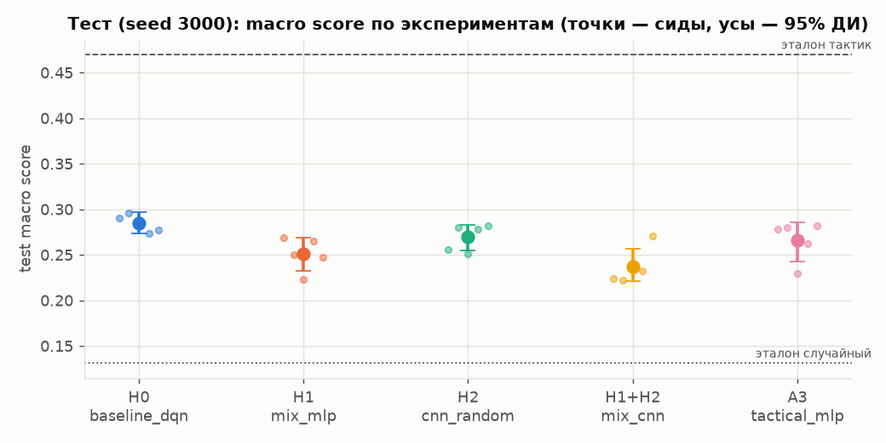

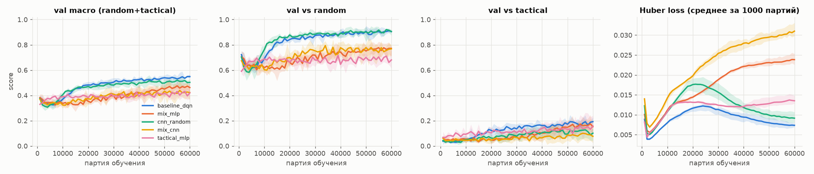

На кривых: против random baseline и CNN выходят на 0,9 к 20 000 партий, плечи с тактиком останавливаются на 0,68–0,78; против тактика все ниже 0,2 (нужна двойная угроза, DQN за этот бюджет ей не учится); Huber loss у плеч со смесью растёт весь период обучения и к финалу в 3–4 раза выше, потому что одна позиция против разных соперников имеет разную ценность и Q-функция усредняет соперников.

## 4. Раунд 1: абляции

Из полной модели `mix_cnn` по очереди убираются оба компонента; третья абляция разбирает сам компонент «смесь».

| Сравнение | Разность | 95% ДИ | По сидам | Вердикт |
|---|---:|---:|---|---|
| H1: `mix_mlp` − `baseline_dqn` | −0,034 | [−0,055; −0,013] | −0,021, −0,046, −0,065, −0,008, −0,029 | значимо хуже; пропуск блока 86,4% → 70,3% |
| H2: `cnn_random` − `baseline_dqn` | −0,016 | [−0,035; +0,003] | −0,034, −0,016, −0,037, +0,004, +0,005 | шум; пропуск победы 27,8% → 33,2% |
| H1+H2: `mix_cnn` − `baseline_dqn` | −0,048 | [−0,071; −0,024] | −0,067, −0,074, −0,053, −0,042, −0,006 | значимо хуже |
| A1: `mix_cnn` − `cnn_random` (убрать смесь) | −0,033 | [−0,052; −0,013] | −0,032, −0,058, −0,015, −0,046, −0,011 | без смеси значимо лучше |
| A2: `mix_cnn` − `mix_mlp` (убрать CNN) | −0,014 | [−0,041; +0,013] | −0,045, −0,028, +0,013, −0,033, +0,023 | шум |
| A3: `mix_mlp` − `tactical_mlp` (убрать random из смеси) | −0,015 | [−0,035; +0,003] | −0,010, −0,030, −0,006, +0,003, −0,034 | шум по macro |
| Взаимодействие (H1+H2) − H1 − H2 + H0 | +0,001 | [−0,028; +0,033] | −0,011, −0,012, +0,050, −0,038, +0,018 | эффекты аддитивны |

- **A1, без смеси.** Удаление смеси *повышает* macro score на 0,033, знак одинаков во всех сидах: вклад смеси отрицательный. Профиль ошибок при этом возвращается: пропуск блока 72% → 86%, результат против random 0,79 → 0,91. Смесь покупает защиту ценой нападения, и цена выше покупки.
- **A2, без CNN.** −0,014, интервал включает ноль, знаки по сидам расходятся. Вклад свёрточной сети при равном числе параметров неотличим от нуля, как и в H2. Узкое место не в том, как сеть видит доску.
- **A3, без random в смеси.** По macro чистый тактик и смесь неразличимы, но это разные агенты: у чистого тактика лучшая защита (пропуск блока 49,7%), единственный заметный результат против агента Kaggle (0,187) и худшая игра против random (0,708, пропуск победы 73,7%). Доля random в пуле двигает агента вдоль одной линии обмена «нападение против защиты», а не добавляет умение.

**Резюме абляций.** Прироста macro score не дало ничего: смесь вредит (A1, значимо), CNN не влияет (A2), состав смеси задаёт профиль ошибок, но не macro (A3). Единственный измеримый плюс в частных метриках: защита лучше у всех плеч с тактиком, результат против агента Kaggle у чистого тактика выше в 4,5 раза. Причина: random даёт 1,18 шанса выиграть в один ход за партию и 0,32 угрозы, тактик 0,32 и 0,76 и каждую свою победу забирает сам. Агент учится тому, за что его наказывают, и разучивается тому, что перестаёт встречать.

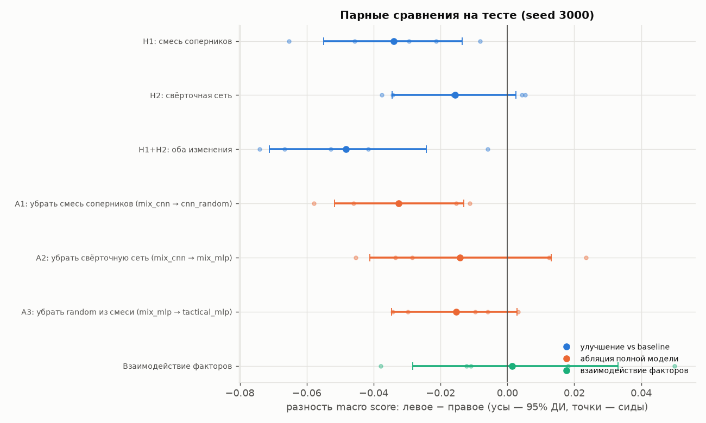

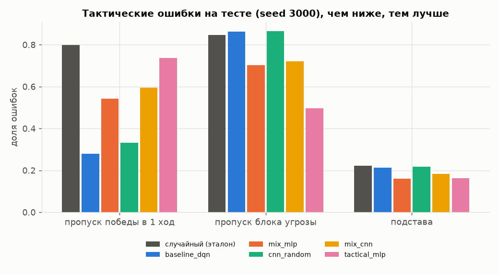

## 5. Честное сравнение

| Условие | Как зафиксировано для всех плеч обоих раундов |
|---|---|
| Разбиение данных | Данные порождает среда, поэтому «разбиение» это отдельные наборы партий с замороженными весами. Валидация: сид 1000, 200 партий против random и 200 против tactical. Тест: сид 3000 (раунд 1) и 4000 (раунд 2), по 400 партий против четырёх соперников. Записаны в конфиге каждого запуска |
| Метрика | macro score, тот же код `summarize`, что в ДЗ1 |
| Предобработка | плоскости 6×7 своих и чужих фишек, маска заполненных столбцов (`board.planes`); в раунде 2 признаки угроз включаются только явным ключом конфига |
| Выбор чекпойнта | `best.pt` равен максимуму валидации; правило одно для всех и проверяется при сборке отчёта |
| Обучение | 60 000 партий, Adam 0,0005, γ = 0,9, буфер 100 000, те же ε и частота обновления целевой сети; отличаются только заявленные ключи |
| Партии теста | одни и те же дебюты и случайность соперника у всех плеч и сидов, поэтому сравнения парные |

Контроль кодом, а не аккуратностью: конфиг плеча строится из `baseline.yaml` плюс override'ы, тест `test_arms_differ_from_baseline_only_by_registered_overrides` падает при любом лишнем отличии; каждый файл результатов проходит `checked_evaluation` (конфиг теста, полнота партий, стороны, дебюты, пересчёт метрики); `check_pairing` проверяет, что все плечи сыграли одни и те же партии; стадия оценки отказывается работать, пока не завершены все обучения, так что нельзя посмотреть тест одного плеча и поменять другое; для baseline переиспользуются чекпойнты ДЗ1 с проверкой конфига и записью SHA-256; результаты проверок печатаются в конце каждого автоотчёта. В раунде 2 код `train.py`, `board.py`, `model.py` расширен, но при выключенных изменениях обучение baseline побитово совпадает с кодом ветки `hw1` (проверено прямым сравнением весов на коротком обучении).

**Подбор под тест исключён.** Тест ДЗ1 (сид 2000) был просмотрен при формулировке гипотез, поэтому раунд 1 получил сид 3000, а раунд 2, начатый после анализа раунда 1, сид 4000. Гиперпараметры не подбирались, единственные априорные выборы (размер CNN по числу параметров, штраф 0,5) сделаны до первого запуска. Валидация используется только для выбора чекпойнта, выводы делаются по тесту.

**Утечки.** Короткие дебюты из двух ходов повторяются между валидацией и тестом, это свойство игры и оно одинаково для всех плеч. Для плеч со смесью тактик в тесте перестаёт быть незнакомым, поэтому обобщение смотрим по поиску на 3 хода и агенту Kaggle, которых ни одно плечо не видело. **Что одинаковым сделать нельзя:** число шагов SGD различается при фиксированном бюджете в партиях (приведено в таблицах), пары «сид k против сида k» условны (бутстреп перевыбирает сиды совместно), интервалы при пяти запусках приблизительны.

## 6. Раунд 1: выводы

- **Прирост.** В основной метрике никакого. В частных: тренировка против тактика снизила пропуск блоков с 86% до 70% (смесь) и 50% (чистый тактик) и подняла результат против агента Kaggle с 0,04 до 0,19, потому что тактик наказывает каждую незакрытую угрозу, а в данных baseline этот сигнал почти отсутствовал. Механизм H1 подтвердился, предсказанный результат нет.
- **Не сработало.** H1: половина партий перестала учить тому, что проверяет половина теста (добивать слабого соперника), пропуск побед вырос вдвое, loss рос весь период. Урок: состав соперников это обмен между умениями, и его надо оценивать по каждому сопернику отдельно; заранее записанный критерий не даёт выдать подтверждённый механизм за подтверждённую гипотезу. H2: ни macro score, ни пропуск побед не изменились, значит простые узоры пропускаются не потому, что сеть не может их увидеть, а потому что сигнал обучения для них слаб. Урок: прежде чем менять архитектуру, проверить, что ограничение в ней. Полная модель худшая, эффекты сложились аддитивно.
- **Шум.** H2, A2, A3, взаимодействие: интервалы включают ноль, знаки по сидам расходятся. Разброс между сидами у новых плеч вдвое больше, чем у baseline. При пяти запусках различимы эффекты от 0,02–0,03. Два соперника из четырёх почти недостижимы для всех плеч, поэтому macro score фактически равен среднему по random и тактику.
- **Что дальше (после раунда 1).** Нужен способ дать сигнал о защите, не меняя соперника и не теряя нападение. Это и проверяет раунд 2.

## 7. Артефакты обоих раундов

- Таблицы экспериментов и запусков с сидами: `experiments.csv`, `runs.csv` в [results/hw2/](results/hw2/) и [results/hw2_round2/](results/hw2_round2/); предсказания (все тестовые партии): `games.csv` там же и `<плечо>/test_seed<k>.json`; парные сравнения: `comparisons.csv`; все числа и SHA-256 чекпойнтов: `summary.json`.
- Графики: по 8 в [results/hw2/figures/](results/hw2/figures/) и [results/hw2_round2/figures/](results/hw2_round2/figures/) (метрика по экспериментам, по соперникам, кривые обучения с loss, тактические ошибки, тепловая карта пропуска блоков, парные разности, факторный план, валидация против теста).
- Примеры ошибочных позиций: разделы «Примеры ошибок» автоотчётов и приложений A, B.
- Чекпойнты, история, конфиг и сводка каждого запуска: `runs/<плечо>/seed<k>/`. Конфиги и реестры: [configs/hw2/](configs/hw2/), [configs/hw2_round2/](configs/hw2_round2/).
- Код: [src/connectx_rl/hw2.py](src/connectx_rl/hw2.py) (конфиги, обучение, оценка, отчёт), тесты [tests/test_hw2.py](tests/test_hw2.py), [tests/test_round2.py](tests/test_round2.py).

## 8. Раунд 2: улучшения по итогам анализа

Раунд 1 показал механизм: соперник учит только тем ошибкам, которые наказывает, а смена соперника меняет профиль ошибок, не улучшая средний результат. Два новых изменения бьют в те же две ошибки baseline, но не через соперника; соперник остаётся random, и нападение не теряется.

> **H3, признаки угроз.** *Если* к двум входным плоскостям добавить ещё две: клетки, где ходящий игрок достраивает четвёрку, и где это делает соперник, *то* macro score вырастет, а пропуск побед и блоков снизится. CNN при равном числе параметров (H2) не снизила пропуск побед, значит дело не в том, как сеть смотрит на доску, а в нехватке сигнала для выучивания 69 узоров; готовый признак снимает эту задачу. Изменение: `model.features: threats`, вход 4×6×7, признак считается битовыми операциями без просмотра вперёд (`Board.threat_cells`). Первый слой растёт с 21,8 до 43,3 тыс. параметров (всего 110,9 тыс.); абляция A4 сравнивает плечи с одинаковым входом.

> **H4, штраф за тактическую ошибку.** *Если* за пропущенную победу и за незакрытую единственную угрозу давать −0,5 к награде перехода независимо от того, наказал ли соперник, *то* macro score вырастет, пропуск блоков снизится, а игра против random сохранится. Наказание переносится из соперника в сигнал обучения. Определение ошибки то же, что в оценке (`train.tactical_error`), величина 0,5 назначена до запуска и не подбиралась, награда за исход и обрезка цели TD до [−1; 1] не меняются. Изменение: `train.shaping: {missed_win: 0.5, missed_block: 0.5}`.

План тот же: 2×2 (`baseline_dqn`, `threats_mlp`, `shaped_mlp`, `threats_shaped_mlp`), сиды 0–4, 60 000 партий, без подбора гиперпараметров; абляции полной модели A4 (убрать признаки) и A5 (убрать штраф). Реестр: [configs/hw2_round2/experiments.yaml](configs/hw2_round2/experiments.yaml). Тест: свежий сид 4000, baseline оценён теми же чекпойнтами ДЗ1. Все проверки честности раунда 1 действуют.

### Результаты раунда 2

| Эксперимент | Гипотеза | Что изменено | Сиды | Параметров | Val | **Test macro** ± std | 95% ДИ | random | тактик | поиск 3 | Kaggle | Пропуск блока | Пропуск победы | SGD, тыс. |
|---|---|---|---|---:|---:|---:|---:|---:|---:|---:|---:|---:|---:|---:|
| `baseline_dqn` | H0 | нет | 0–4 | 89 351 | 0,569 | **0,285 ± 0,010** | [0,273; 0,297] | 0,904 | 0,197 | 0,001 | 0,037 | 87,0% | 30,8% | 350 |
| `threats_mlp` | H3 | вход + плоскости угроз | 0–4 | 110 855 | 0,577 | **0,287 ± 0,005** | [0,276; 0,297] | 0,889 | 0,207 | 0,000 | 0,049 | 78,5% | 26,4% | 335 |
| `shaped_mlp` | H4 | штраф −0,5 за ошибку | 0–4 | 89 351 | 0,576 | **0,291 ± 0,003** | [0,282; 0,302] | 0,910 | 0,192 | 0,001 | 0,063 | 68,0% | 27,0% | 384 |
| `threats_shaped_mlp` | H3+H4 | оба | 0–4 | 110 855 | 0,657 | **0,345 ± 0,008** | [0,334; 0,357] | 0,965 | 0,293 | 0,008 | 0,114 | 48,9% | 10,2% | 337 |

Baseline на сиде 4000 дал 0,285, как и на сиде 3000. Настенное время обучения (около 2 ч на запуск) непоказательно: 15 процессов на 15 ядрах при включённом режиме энергосбережения.

| Сравнение | Разность | 95% ДИ | По сидам | Вердикт |
|---|---:|---:|---|---|
| H3: `threats_mlp` − `baseline_dqn` | +0,002 | [−0,014; +0,016] | +0,000, +0,001, −0,020, +0,020, +0,008 | шум; пропуск победы 30,8% → 26,4% |
| H4: `shaped_mlp` − `baseline_dqn` | +0,007 | [−0,005; +0,019] | +0,003, +0,001, −0,006, +0,020, +0,015 | шум; пропуск блока 87,0% → 68,0% |
| H3+H4: `threats_shaped_mlp` − `baseline_dqn` | **+0,060** | [+0,046; +0,075] | +0,068, +0,053, +0,042, +0,062, +0,075 | **значимо лучше на всех сидах**, обе ошибки снизились |
| A4: полная − `shaped_mlp` (убрать признаки) | +0,053 | [+0,041; +0,067] | +0,066, +0,052, +0,047, +0,042, +0,060 | без признаков значимо хуже |
| A5: полная − `threats_mlp` (убрать штраф) | +0,058 | [+0,044; +0,073] | +0,068, +0,052, +0,062, +0,043, +0,067 | без штрафа значимо хуже |
| Взаимодействие (H3+H4) − H3 − H4 + H0 | +0,052 | [+0,031; +0,072] | +0,065, +0,051, +0,067, +0,022, +0,053 | не аддитивно, нужны оба |

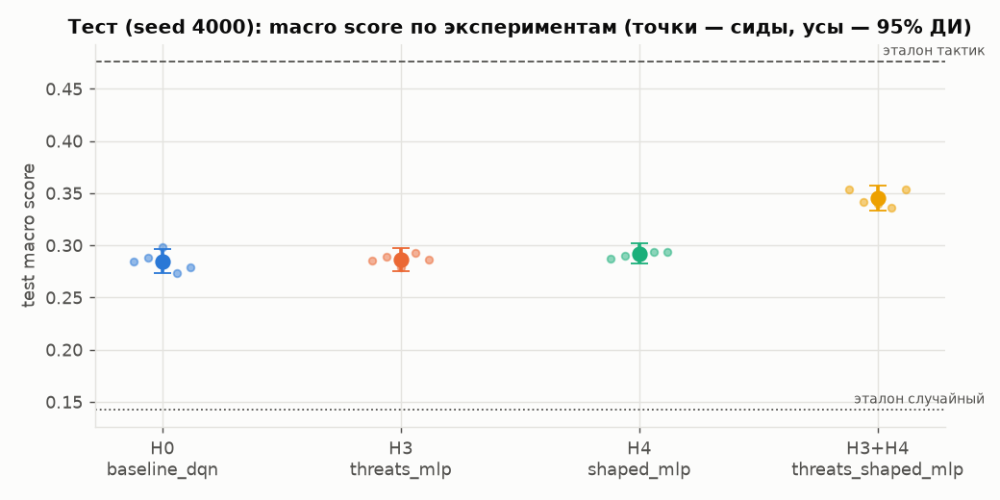

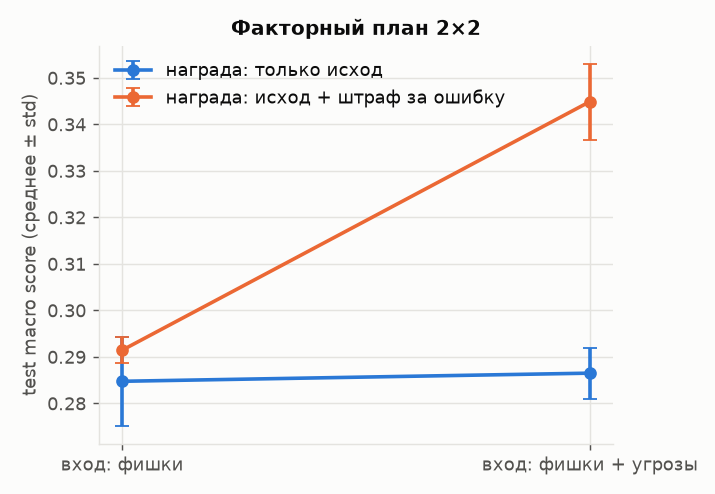

**Критерий ДЗ1 выполнен для полной модели:** нижняя граница ДИ +0,046, знак положительный на всех пяти сидах, пропуск победы 30,8% → 10,2%, пропуск блока 87,0% → 48,9%. Лучше baseline против каждого соперника: random 0,90 → 0,97, тактик 0,20 → 0,29, агент Kaggle 0,04 → 0,11, впервые ненулевые очки против поиска на 3 хода. Это единственный за оба раунда случай, когда улучшились и защита, и нападение.

### Абляции раунда 2

- **A4, без признаков.** −0,053 при том же штрафе. Один штраф снижает пропуск блока с 87% до 68% и дальше не идёт: сеть наказывают за ошибку, которую она не умеет увидеть, loss у `shaped_mlp` самый высокий из всех плеч.
- **A5, без штрафа.** −0,058 при тех же признаках. Одни признаки почти не используются (пропуск блока 78,5%), результат равен baseline: награда только за исход при γ = 0,9 и случайном сопернике не даёт повода связать признак с ценностью хода, random наказывает незакрытую угрозу лишь в одном случае из семи.
- **Резюме.** Прирост даёт только сочетание: признак показывает, где ошибка, штраф объясняет, что она стоит дорого. Взаимодействие +0,052 больше любого одиночного эффекта, это одно улучшение из двух необходимых частей. Согласуется с раундом 1: там тактик давал и сигнал, и наказание, но ценой нападения; здесь они разделены и не требуют менять соперника.

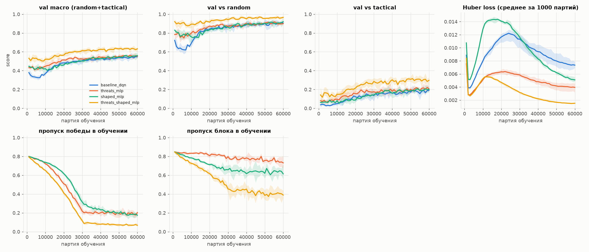

На кривых доля пропущенных блоков в тренировочных партиях у полной модели падает до 0,4 к 30 000 партии, у `shaped_mlp` останавливается на 0,65, у `threats_mlp` на 0,75 (для baseline эти счётчики не записывались, чекпойнты ДЗ1 не переобучались). Loss полной модели ниже в три раза: признаки упрощают саму регрессию, а не только политику.

### Что не сработало, что шум и ограничения

- H3 и H4 по отдельности: +0,002 и +0,007, интервалы включают ноль. Гипотезы «каждое изменение само поднимет macro score» не подтвердились. Урок: разбор ошибок верно указал цель, но недооценил, что признак и сигнал обучения нужны вместе.
- У полной модели доля подстав (ход под угрозу соперника) выросла с 23% до 26%: штраф наказывает только две ошибки, и агент, став смелее, чаще ходит под чужую четвёрку. Кандидат на следующую итерацию, а не повод менять штраф задним числом.
- Параметров у плеч с признаками больше на 21,5 тыс., но `threats_mlp` без штрафа равен baseline, так что прирост объясняется не ёмкостью. Величина штрафа и состав признаков не варьировались; неизвестно, догнали бы одиночные изменения полную модель при большем бюджете. Два тестовых соперника из четырёх почти недостижимы для всех плеч.

### Итог ДЗ2 и что дальше

За два раунда проверены четыре улучшения и семь абляций и контрастов. Сработало одно сочетание из двух частей, закрывающих две независимые нехватки baseline: сеть не видела узор «три в ряд» как признак, а награда за исход почти никогда не связывала ошибку с её ценой. Для ДЗ3: разбор ошибок полной модели (рост подстав, устойчивость прироста к стороне, дебюту и сиду) и проверка на сопернике, которого не было ни в обучении, ни в тесте.

## 9. Соответствие требованиям задания

| Требование ДЗ2 | Где выполнено |
|---|---|
| 1–2 обоснованных улучшения с гипотезой, без перебора параметров | §2 (H1, H2 из разбора ошибок ДЗ1), §8 (H3, H4 из анализа раунда 1); гипотезы записаны в реестрах до запуска, гиперпараметры не подбирались, это проверяет тест |
| Трекинг: конфигурация, метрики, seed, гипотеза, визуальные артефакты | §3, §8: таблицы с гипотезой, сидами и единой метрикой; `experiments.csv`, `runs.csv` по сидам, история и чекпойнты в `runs/`, кривые обучения |
| Минимум 2 абляции, вывод по каждой, резюме | §4 (A1–A3, взаимодействие), §8 (A4, A5, взаимодействие) |
| Честное сравнение, контроль утечек | §5: одинаковые условия, проверки в коде, свежие тестовые сиды 3000 и 4000, разбор утечек; результаты проверок в приложениях |
| Выводы: прирост и почему, что не сработало и уроки, что шум | §6, §8 |
| Артефакты: таблица, графики (метрика, кривые, loss), визуализации ошибок, CSV с предсказаниями | §7 и приложения: по 8 графиков на раунд, все тестовые партии в `games.csv`, примеры ошибочных позиций |
| Воспроизводимость: код, инструкция, seed, конфиги | §1, `configs/hw2*/`, сиды 0–4 / 1000 / 3000 / 4000, 308 тестов |
| Удачные и неудачные попытки явно | §1, §6, §8 |

## Приложение A: детальные таблицы раунда 1

Разделы ниже скопированы из [results/hw2/report.md](results/hw2/report.md) и обновляются автоматически командой `bash scripts/run_hw2.sh --stage report`. Остальные разделы автоотчёта (гипотезы, таблица экспериментов, парные сравнения, кривые обучения) уже приведены в §2–§4.

<!-- autoreport:start -->
### Тест: результат против каждого соперника

| Агент | случайный | тактик | поиск на 3 хода | агент Kaggle | **Среднее** |
|---|---:|---:|---:|---:|---:|
| случайный (эталон) | 0,476 | 0,025 | 0,000 | 0,024 | 0,131 [0,118; 0,144] |
| тактик (эталон) | 0,971 | 0,506 | 0,034 | 0,369 | 0,470 [0,452; 0,487] |
| поиск на 3 хода (эталон) | 1,000 | 0,973 | 0,505 | 0,939 | 0,854 [0,841; 0,868] |
| **`baseline_dqn`** | 0,910 ± 0,011 | 0,190 ± 0,020 | 0,000 ± 0,000 | 0,040 ± 0,016 | **0,285 ± 0,009** [0,273; 0,297] |
| **`mix_mlp`** | 0,784 ± 0,032 | 0,161 ± 0,037 | 0,000 ± 0,000 | 0,059 ± 0,016 | **0,251 ± 0,018** [0,232; 0,269] |
| **`cnn_random`** | 0,911 ± 0,020 | 0,122 ± 0,041 | 0,002 ± 0,001 | 0,043 ± 0,009 | **0,269 ± 0,015** [0,255; 0,283] |
| **`mix_cnn`** | 0,787 ± 0,039 | 0,107 ± 0,053 | 0,001 ± 0,001 | 0,052 ± 0,011 | **0,237 ± 0,020** [0,221; 0,257] |
| **`tactical_mlp`** | 0,708 ± 0,050 | 0,163 ± 0,043 | 0,007 ± 0,005 | 0,187 ± 0,052 | **0,266 ± 0,022** [0,243; 0,286] |


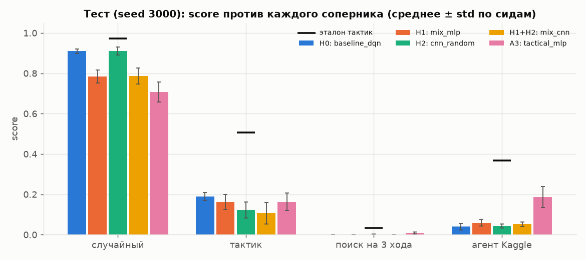

### Результаты по запускам

| Эксперимент | Сид | Эпизод лучшего чекпойнта | Val | Test macro | случайный | тактик | поиск на 3 хода | агент Kaggle | Пропуск блока | Пропуск победы | Обучение, с |
|---|---:|---:|---:|---:|---:|---:|---:|---:|---:|---:|---:|
| `baseline_dqn` | 0 | 57 000 | 0,589 | 0,290 | 0,902 | 0,200 | 0,000 | 0,058 | 86,2% | 30,9% | 668 |
| `baseline_dqn` | 1 | 51 000 | 0,568 | 0,296 | 0,927 | 0,201 | 0,000 | 0,055 | 87,4% | 24,8% | 647 |
| `baseline_dqn` | 2 | 60 000 | 0,566 | 0,288 | 0,912 | 0,204 | 0,000 | 0,037 | 86,0% | 28,3% | 636 |
| `baseline_dqn` | 3 | 49 000 | 0,555 | 0,273 | 0,907 | 0,155 | 0,000 | 0,031 | 83,8% | 24,4% | 633 |
| `baseline_dqn` | 4 | 51 000 | 0,565 | 0,277 | 0,900 | 0,188 | 0,000 | 0,020 | 88,5% | 30,1% | 649 |
| `mix_mlp` | 0 | 52 000 | 0,529 | 0,269 | 0,812 | 0,182 | 0,000 | 0,080 | 66,7% | 52,6% | 1379 |
| `mix_mlp` | 1 | 49 000 | 0,494 | 0,250 | 0,760 | 0,190 | 0,000 | 0,051 | 70,4% | 52,6% | 1362 |
| `mix_mlp` | 2 | 55 000 | 0,480 | 0,223 | 0,744 | 0,098 | 0,000 | 0,051 | 70,7% | 59,7% | 1433 |
| `mix_mlp` | 3 | 55 000 | 0,502 | 0,265 | 0,818 | 0,172 | 0,000 | 0,071 | 70,2% | 53,7% | 1380 |
| `mix_mlp` | 4 | 60 000 | 0,485 | 0,247 | 0,787 | 0,163 | 0,000 | 0,040 | 73,7% | 52,5% | 1370 |
| `cnn_random` | 0 | 48 000 | 0,525 | 0,256 | 0,882 | 0,094 | 0,003 | 0,044 | 88,2% | 41,3% | 67678 |
| `cnn_random` | 1 | 55 000 | 0,536 | 0,280 | 0,927 | 0,150 | 0,003 | 0,039 | 87,1% | 30,5% | 68468 |
| `cnn_random` | 2 | 37 000 | 0,499 | 0,251 | 0,902 | 0,069 | 0,003 | 0,030 | 86,7% | 32,7% | 67726 |
| `cnn_random` | 3 | 44 000 | 0,560 | 0,278 | 0,932 | 0,131 | 0,000 | 0,048 | 86,1% | 28,4% | 67575 |
| `cnn_random` | 4 | 54 000 | 0,550 | 0,282 | 0,907 | 0,168 | 0,000 | 0,054 | 84,6% | 32,3% | 67638 |
| `mix_cnn` | 0 | 28 000 | 0,456 | 0,223 | 0,748 | 0,080 | 0,000 | 0,066 | 70,2% | 67,5% | 69629 |
| `mix_cnn` | 1 | 29 000 | 0,471 | 0,222 | 0,748 | 0,091 | 0,000 | 0,049 | 75,7% | 62,4% | 69723 |
| `mix_cnn` | 2 | 37 000 | 0,468 | 0,236 | 0,809 | 0,072 | 0,000 | 0,061 | 65,1% | 61,7% | 69728 |
| `mix_cnn` | 3 | 43 000 | 0,459 | 0,232 | 0,795 | 0,091 | 0,003 | 0,039 | 75,8% | 56,9% | 69700 |
| `mix_cnn` | 4 | 51 000 | 0,512 | 0,271 | 0,838 | 0,201 | 0,000 | 0,045 | 74,4% | 45,4% | 69448 |
| `tactical_mlp` | 0 | 55 000 | 0,509 | 0,278 | 0,688 | 0,236 | 0,003 | 0,188 | 53,9% | 70,2% | 1583 |
| `tactical_mlp` | 1 | 58 000 | 0,463 | 0,280 | 0,706 | 0,156 | 0,003 | 0,255 | 48,0% | 73,4% | 1634 |
| `tactical_mlp` | 2 | 29 000 | 0,448 | 0,229 | 0,652 | 0,138 | 0,015 | 0,111 | 48,7% | 77,3% | 1624 |
| `tactical_mlp` | 3 | 39 000 | 0,465 | 0,262 | 0,708 | 0,155 | 0,010 | 0,176 | 50,3% | 75,1% | 1638 |
| `tactical_mlp` | 4 | 37 000 | 0,435 | 0,282 | 0,787 | 0,128 | 0,007 | 0,205 | 48,1% | 72,2% | 1628 |

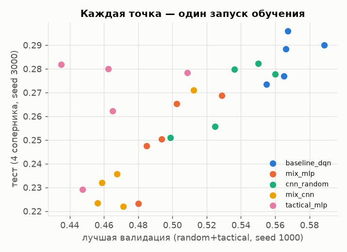

### Тактические ошибки

Доля считается от числа позиций, где такая ошибка была возможна (микро-усреднение по всем сидам и соперникам).

| Агент | пропуск победы в 1 ход | пропуск блока угрозы | подстава |
|---|---:|---:|---:|
| случайный (эталон) | 79,9% | 84,7% | 22,2% |
| тактик (эталон) | 0,0% | 0,0% | 0,0% |
| поиск на 3 хода (эталон) | 0,0% | 2,9% | 0,0% |
| **`baseline_dqn`** | 27,8% | 86,4% | 21,2% |
| **`mix_mlp`** | 54,2% | 70,3% | 16,0% |
| **`cnn_random`** | 33,2% | 86,5% | 21,7% |
| **`mix_cnn`** | 59,5% | 72,0% | 18,4% |
| **`tactical_mlp`** | 73,7% | 49,7% | 16,1% |


Пропуск блока по соперникам (строка — эксперимент):

| Эксперимент | случайный | тактик | поиск на 3 хода | агент Kaggle |
|---|---:|---:|---:|---:|
| `baseline_dqn` | 83,9% | 84,7% | 89,0% | 86,4% |
| `mix_mlp` | 70,2% | 73,4% | 72,7% | 66,3% |
| `cnn_random` | 86,7% | 83,3% | 88,7% | 87,5% |
| `mix_cnn` | 71,4% | 73,6% | 73,8% | 69,9% |
| `tactical_mlp` | 58,8% | 50,4% | 53,1% | 41,1% |

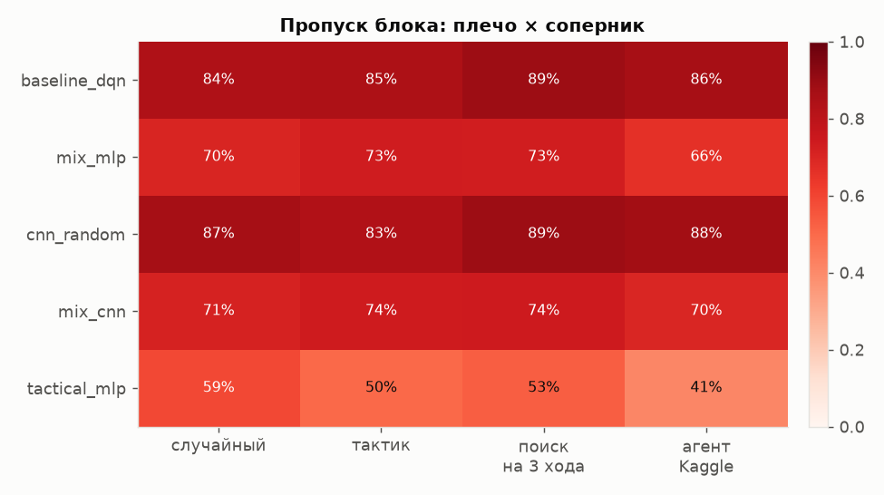

### Примеры ошибок

Столбцы 0–6 слева направо, точка — пустая клетка.

#### Лучшее плечо: `baseline_dqn`

**Пропущенная победа.** Соперник «случайный», партия 0.
```
. . . . . . .
. . . . . . .
. . O . . . .
. . O . . . .
O . X X X . O
O X X O X O X
0 1 2 3 4 5 6
  *     ^ *
Агент играет X. Знак ^ показывает ход агента, знак * показывает правильные ходы.
```

**Пропущенный блок.** Соперник «случайный», партия 5.
```
. . . . . . .
. . . . . . .
. . . . . . .
. . . . . . .
. . O . . . .
. . O X X X .
0 1 2 3 4 5 6
    ^       *
Агент играет O. Знак ^ показывает ход агента, знак * показывает правильные ходы.
```

**Подстава.** Соперник «случайный», партия 37.
```
. . . . . . .
. . . . . . .
. . . O . . .
. . . X . . .
. . X O O . .
. X X O X . .
0 1 2 3 4 5 6
* * * * ^ * *
Агент играет O. Знак ^ показывает ход агента, знак * показывает правильные ходы.
```

#### Новые плечи: ошибка, которая стала чаще всего

Для каждого плеча показана ошибка, доля которой выросла сильнее всего относительно `baseline_dqn`. Это разбор того, что именно сломалось.

`mix_mlp`: пропуск победы в 1 ход 27,8% → 54,2%.

**Пропущенная победа.** Соперник «случайный», партия 0.
```
. . . . . . .
. . . . . . .
O . . X . . .
O . X X . X .
X . O X . X O
O X O O X O O
0 1 2 3 4 5 6
  ^   *
Агент играет X. Знак ^ показывает ход агента, знак * показывает правильные ходы.
```

`cnn_random`: пропуск победы в 1 ход 27,8% → 33,2%.

**Пропущенная победа.** Соперник «случайный», партия 0.
```
. . . . . . .
. . . . . . .
. . O . . . .
. . O . . . .
. . X X X . .
O X X O X O O
0 1 2 3 4 5 6
  *     ^ *
Агент играет X. Знак ^ показывает ход агента, знак * показывает правильные ходы.
```

`mix_cnn`: пропуск победы в 1 ход 27,8% → 59,5%.

**Пропущенная победа.** Соперник «случайный», партия 0.
```
. . . . . . .
. . . . . . .
. . . . . . .
. . . X . . .
. . O X . X X
O X O O X O O
0 1 2 3 4 5 6
  ^     *
Агент играет X. Знак ^ показывает ход агента, знак * показывает правильные ходы.
```

`tactical_mlp`: пропуск победы в 1 ход 27,8% → 73,7%.

**Пропущенная победа.** Соперник «случайный», партия 0.
```
. . . . . . .
. . . . . . .
. . . . . . .
O X . . . X .
X X O X . O .
O X O O . X O
0 1 2 3 4 5 6
  * ^
Агент играет X. Знак ^ показывает ход агента, знак * показывает правильные ходы.
```

### Автоматические проверки честности

- Конфиг валидации одинаков у всех плеч: **да** (seed 1000).
- Конфиг теста одинаков у всех оценок: **да** (seed 3000; тест ДЗ1 имел seed 2000, валидация seed 1000).
- Ключи `train`, одинаковые у всех плеч: `episodes`, `gamma`, `lr`, `batch_size`, `buffer_size`, `warmup_transitions`, `train_every`, `target_update_every`, `double_dqn`, `target_clip`, `grad_clip`, `eps_start`, `eps_end`, `eps_decay_episodes`, `log_every`, `val_every`.
- Ключи `train`, различающиеся между плечами: `opponents`.
- best.pt = максимум val_macro по истории обучения (проверено для каждого сида).
- Одни и те же партии у всех плеч (ID, сторона, дебют): проверено функцией `check_pairing`.
- SHA-256 всех оценённых чекпойнтов записаны в [summary.json](results/hw2/summary.json).
<!-- autoreport:end -->

## Приложение B: детальные таблицы раунда 2

Разделы ниже скопированы из [results/hw2_round2/report.md](results/hw2_round2/report.md) и обновляются автоматически командой `bash scripts/run_hw2.sh --registry configs/hw2_round2/experiments.yaml --stage report`.

<!-- autoreport:r2:start -->
### Тест: результат против каждого соперника

| Агент | случайный | тактик | поиск на 3 хода | агент Kaggle | **Среднее** |
|---|---:|---:|---:|---:|---:|
| случайный (эталон) | 0,494 | 0,039 | 0,000 | 0,037 | 0,142 [0,129; 0,156] |
| тактик (эталон) | 0,966 | 0,510 | 0,033 | 0,396 | 0,476 [0,460; 0,494] |
| поиск на 3 хода (эталон) | 1,000 | 0,959 | 0,477 | 0,958 | 0,848 [0,835; 0,862] |
| **`baseline_dqn`** | 0,904 ± 0,015 | 0,197 ± 0,030 | 0,001 ± 0,001 | 0,037 ± 0,010 | **0,285 ± 0,010** [0,273; 0,297] |
| **`threats_mlp`** | 0,889 ± 0,009 | 0,207 ± 0,017 | 0,000 ± 0,000 | 0,049 ± 0,010 | **0,287 ± 0,005** [0,276; 0,297] |
| **`shaped_mlp`** | 0,910 ± 0,012 | 0,192 ± 0,012 | 0,001 ± 0,001 | 0,063 ± 0,010 | **0,291 ± 0,003** [0,282; 0,302] |
| **`threats_shaped_mlp`** | 0,965 ± 0,006 | 0,293 ± 0,019 | 0,008 ± 0,008 | 0,114 ± 0,017 | **0,345 ± 0,008** [0,334; 0,357] |


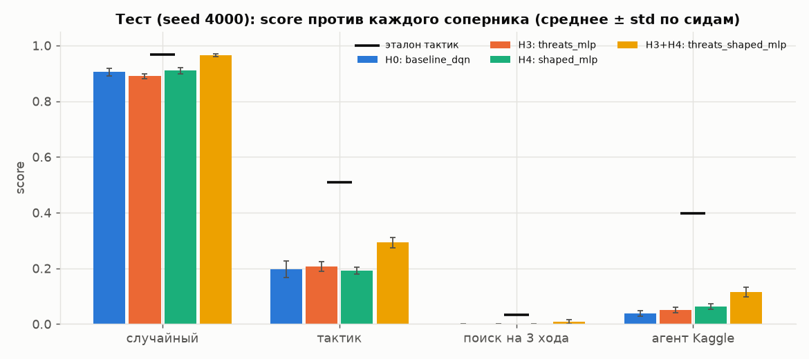

### Результаты по запускам

| Эксперимент | Сид | Эпизод лучшего чекпойнта | Val | Test macro | случайный | тактик | поиск на 3 хода | агент Kaggle | Пропуск блока | Пропуск победы | Обучение, с |
|---|---:|---:|---:|---:|---:|---:|---:|---:|---:|---:|---:|
| `baseline_dqn` | 0 | 57 000 | 0,589 | 0,285 | 0,882 | 0,206 | 0,003 | 0,048 | 87,1% | 33,1% | 668 |
| `baseline_dqn` | 1 | 51 000 | 0,568 | 0,288 | 0,905 | 0,203 | 0,000 | 0,046 | 88,0% | 35,4% | 647 |
| `baseline_dqn` | 2 | 60 000 | 0,566 | 0,298 | 0,922 | 0,234 | 0,000 | 0,037 | 85,6% | 28,4% | 636 |
| `baseline_dqn` | 3 | 49 000 | 0,555 | 0,273 | 0,910 | 0,152 | 0,000 | 0,031 | 85,7% | 32,6% | 633 |
| `baseline_dqn` | 4 | 51 000 | 0,565 | 0,279 | 0,902 | 0,188 | 0,000 | 0,025 | 88,5% | 23,3% | 649 |
| `threats_mlp` | 0 | 39 000 | 0,585 | 0,285 | 0,877 | 0,217 | 0,000 | 0,045 | 81,6% | 25,4% | 7425 |
| `threats_mlp` | 1 | 56 000 | 0,579 | 0,289 | 0,900 | 0,193 | 0,000 | 0,065 | 78,4% | 27,3% | 7417 |
| `threats_mlp` | 2 | 53 000 | 0,568 | 0,278 | 0,885 | 0,185 | 0,000 | 0,044 | 76,6% | 26,8% | 7429 |
| `threats_mlp` | 3 | 56 000 | 0,580 | 0,293 | 0,895 | 0,225 | 0,000 | 0,052 | 78,3% | 26,0% | 7436 |
| `threats_mlp` | 4 | 57 000 | 0,575 | 0,287 | 0,890 | 0,216 | 0,000 | 0,040 | 77,8% | 26,7% | 7426 |
| `shaped_mlp` | 0 | 60 000 | 0,587 | 0,287 | 0,922 | 0,175 | 0,000 | 0,052 | 69,7% | 28,4% | 7442 |
| `shaped_mlp` | 1 | 59 000 | 0,589 | 0,290 | 0,902 | 0,184 | 0,000 | 0,072 | 65,7% | 26,2% | 7437 |
| `shaped_mlp` | 2 | 53 000 | 0,565 | 0,293 | 0,920 | 0,198 | 0,000 | 0,054 | 69,3% | 26,4% | 7440 |
| `shaped_mlp` | 3 | 59 000 | 0,565 | 0,294 | 0,895 | 0,205 | 0,003 | 0,072 | 67,0% | 28,8% | 7427 |
| `shaped_mlp` | 4 | 47 000 | 0,573 | 0,293 | 0,910 | 0,199 | 0,000 | 0,065 | 68,7% | 25,1% | 7438 |
| `threats_shaped_mlp` | 0 | 48 000 | 0,652 | 0,353 | 0,968 | 0,289 | 0,013 | 0,144 | 46,9% | 11,3% | 7440 |
| `threats_shaped_mlp` | 1 | 47 000 | 0,654 | 0,342 | 0,970 | 0,290 | 0,000 | 0,107 | 54,5% | 9,3% | 7434 |
| `threats_shaped_mlp` | 2 | 42 000 | 0,655 | 0,340 | 0,960 | 0,280 | 0,007 | 0,113 | 49,3% | 9,4% | 7431 |
| `threats_shaped_mlp` | 3 | 39 000 | 0,657 | 0,336 | 0,958 | 0,280 | 0,000 | 0,105 | 47,4% | 11,2% | 7436 |
| `threats_shaped_mlp` | 4 | 58 000 | 0,666 | 0,354 | 0,970 | 0,325 | 0,018 | 0,102 | 46,8% | 9,7% | 7426 |

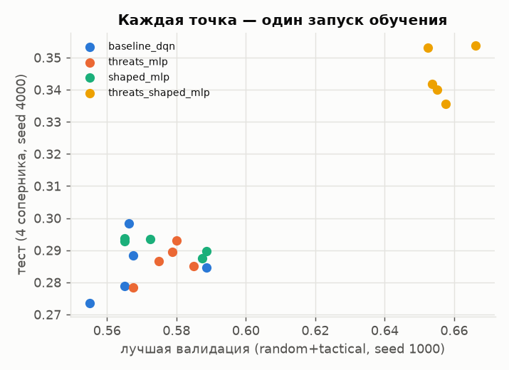

### Тактические ошибки

Доля считается от числа позиций, где такая ошибка была возможна (микро-усреднение по всем сидам и соперникам).

| Агент | пропуск победы в 1 ход | пропуск блока угрозы | подстава |
|---|---:|---:|---:|
| случайный (эталон) | 78,8% | 84,0% | 22,4% |
| тактик (эталон) | 0,0% | 0,0% | 0,0% |
| поиск на 3 хода (эталон) | 0,0% | 3,7% | 0,0% |
| **`baseline_dqn`** | 30,8% | 87,0% | 23,1% |
| **`threats_mlp`** | 26,4% | 78,5% | 23,0% |
| **`shaped_mlp`** | 27,0% | 68,0% | 20,7% |
| **`threats_shaped_mlp`** | 10,2% | 48,9% | 26,2% |

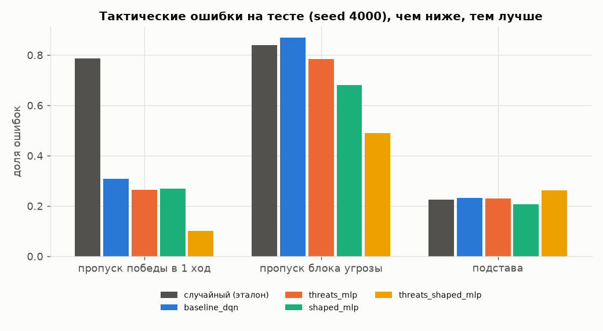

Пропуск блока по соперникам (строка — эксперимент):

| Эксперимент | случайный | тактик | поиск на 3 хода | агент Kaggle |
|---|---:|---:|---:|---:|
| `baseline_dqn` | 85,9% | 83,3% | 90,0% | 87,8% |
| `threats_mlp` | 78,3% | 77,8% | 77,9% | 79,7% |
| `shaped_mlp` | 67,2% | 71,2% | 65,7% | 68,0% |
| `threats_shaped_mlp` | 34,8% | 52,2% | 48,0% | 50,2% |

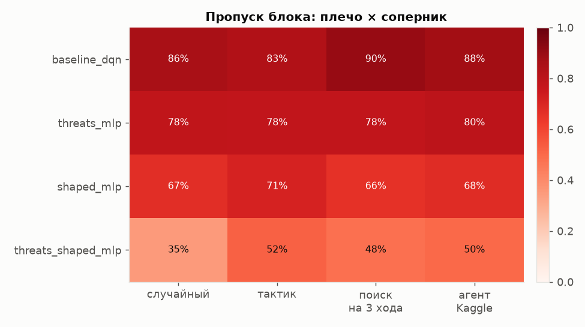

### Примеры ошибок

Столбцы 0–6 слева направо, точка — пустая клетка.

#### Лучшее плечо: `threats_shaped_mlp`

**Пропущенная победа.** Соперник «случайный», партия 1.
```
O . . O . . .
X . . X . X .
X . . O . X .
O . O O . X .
O X O X . O .
X X X O X O .
0 1 2 3 4 5 6
  * ^
Агент играет O. Знак ^ показывает ход агента, знак * показывает правильные ходы.
```

**Пропущенный блок.** Соперник «случайный», партия 1.
```
O . . O . . .
X . . X . X .
X . . O . X .
O . . O . X .
O . O X . O .
X X X O X O .
0 1 2 3 4 5 6
    ^     *
Агент играет O. Знак ^ показывает ход агента, знак * показывает правильные ходы.
```

**Подстава.** Соперник «случайный», партия 1.
```
. . . . . . .
. . . . . . .
. . . X . X .
. . . O . X .
X O . X . O .
X O X O X O O
0 1 2 3 4 5 6
* * * * ^ * *
Агент играет O. Знак ^ показывает ход агента, знак * показывает правильные ходы.
```

#### Новые плечи: ошибка, которая стала чаще всего

Для каждого плеча показана ошибка, доля которой выросла сильнее всего относительно `baseline_dqn`. Это разбор того, что именно сломалось.

`threats_mlp`: ни один тип ошибок не стал чаще, чем у `baseline_dqn`.

`shaped_mlp`: ни один тип ошибок не стал чаще, чем у `baseline_dqn`.

`threats_shaped_mlp`: подстава 23,1% → 26,2%.

**Подстава.** Соперник «случайный», партия 1.
```
. . . . . . .
. . . . . . .
. . . X . X .
. . . O . X .
X O . X . O .
X O X O X O O
0 1 2 3 4 5 6
* * * * ^ * *
Агент играет O. Знак ^ показывает ход агента, знак * показывает правильные ходы.
```

### Автоматические проверки честности

- Конфиг валидации одинаков у всех плеч: **да** (seed 1000).
- Конфиг теста одинаков у всех оценок: **да** (seed 4000; тест ДЗ1 имел seed 2000, валидация seed 1000).
- Ключи `train`, одинаковые у всех плеч: `opponents`, `episodes`, `gamma`, `lr`, `batch_size`, `buffer_size`, `warmup_transitions`, `train_every`, `target_update_every`, `double_dqn`, `target_clip`, `grad_clip`, `eps_start`, `eps_end`, `eps_decay_episodes`, `log_every`, `val_every`.
- Ключи `train`, различающиеся между плечами: `shaping`.
- best.pt = максимум val_macro по истории обучения (проверено для каждого сида).
- Одни и те же партии у всех плеч (ID, сторона, дебют): проверено функцией `check_pairing`.
- SHA-256 всех оценённых чекпойнтов записаны в [summary.json](results/hw2_round2/summary.json).
<!-- autoreport:r2:end -->

