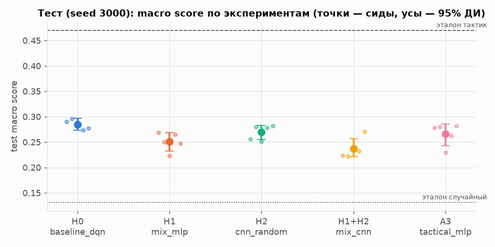
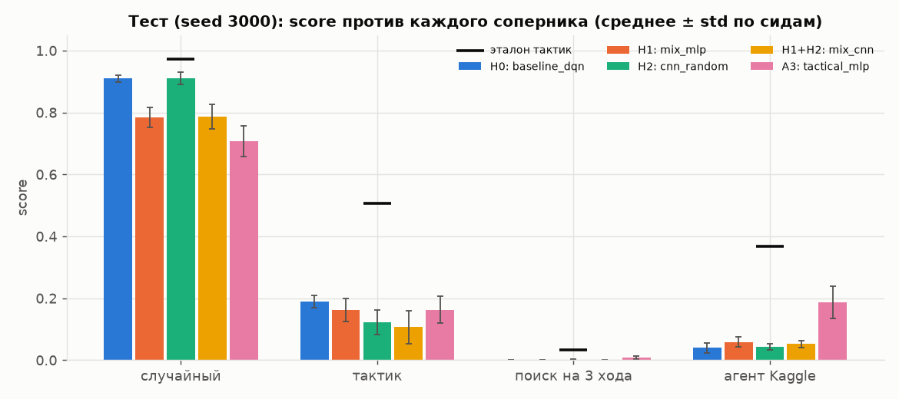
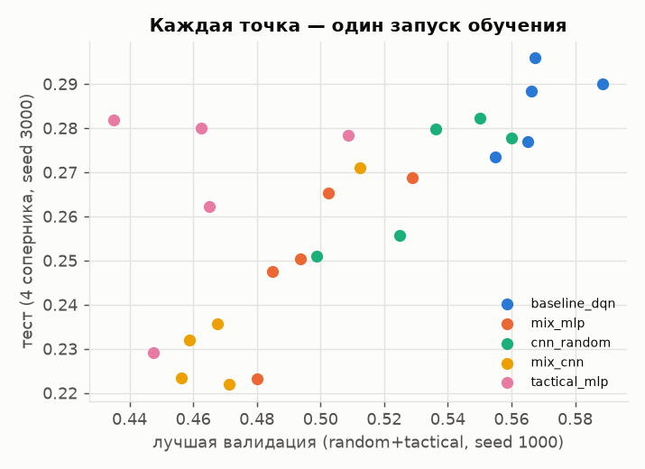
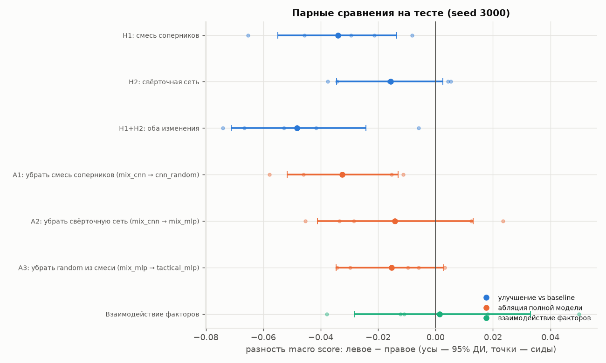
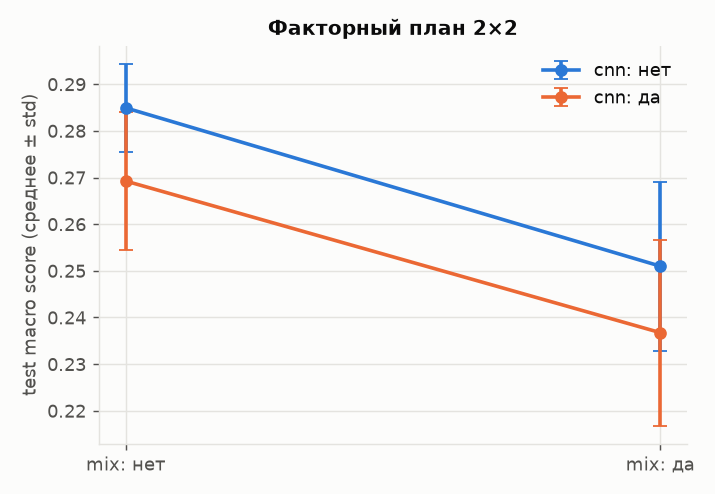
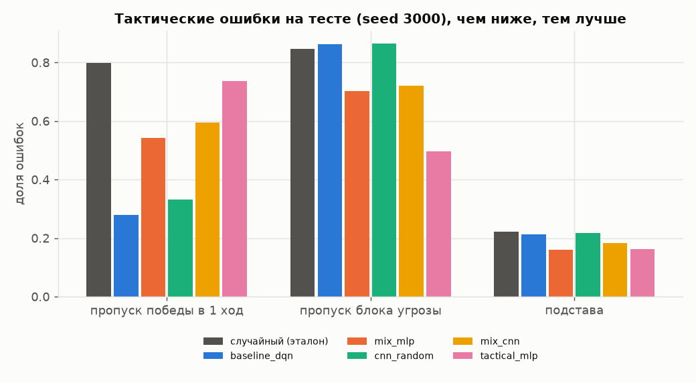
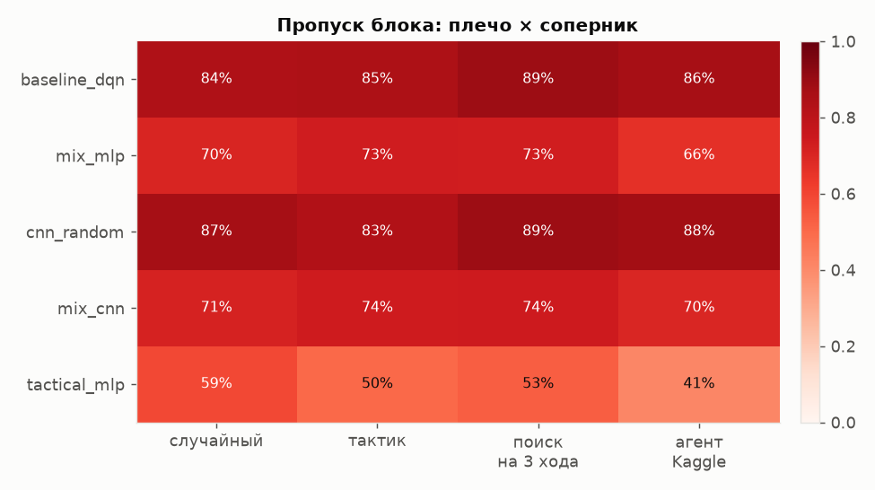
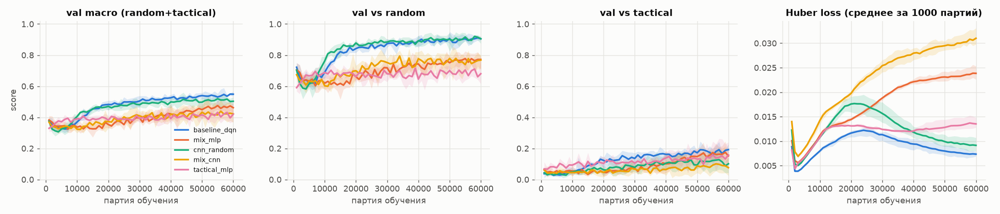

# ДЗ2: отчёт по экспериментам, абляциям и честному сравнению

Отчёт собран автоматически командой `python -m connectx_rl.hw2 --stage report` из сохранённых партий. Метрика та же, что в ДЗ1: 1 очко за победу, 0,5 за ничью, 0 за поражение, среднее по четырём соперникам (macro score). Тест ДЗ2: seed 3000, 400 партий с каждым соперником, 2 случайных первых хода, половина партий первым ходом. Знак ± обозначает стандартное отклонение по запускам обучения, в квадратных скобках 95% доверительный интервал (перекрёстный бутстреп по запускам и партиям, 2000 повторений).

## Гипотезы

- **H0 (baseline_dqn)** — Baseline ДЗ1: MLP 2×256, соперник random. Изменение: нет (точка отсчёта). Точка отсчёта. Ожидаем ~0,29 на новом тесте, как и на тесте ДЗ1 (0,293 ± 0,015).
- **H1 (mix_mlp)** — H1: смесь соперников random+tactical, MLP. Изменение: train.opponents: [random] → [random, tactical] (выбор соперника на партию равновероятный). Случайный соперник почти не создаёт угроз, поэтому baseline негде учиться защите и он пропускает 86,6% блоков. Тактик строит угрозы постоянно и наказывает за каждую незакрытую. Мы считаем, что обучение против смеси random+tactical даст сигнал для защиты, поэтому пробуем смесь 50/50 при той же сети и том же числе партий. Ожидание: рост macro score и снижение доли пропущенных блоков.
- **H2 (cnn_random)** — H2: свёрточная сеть (16,16)+FC128, соперник random. Изменение: model: MLP 84→256→256→7 (89 351 парам.) → Conv3x3(2→16)→Conv3x3(16→16)→FC(672→128)→7 (89 671 парам.). «Четыре в ряд» — один и тот же локальный узор в любом месте доски, а baseline пропускает 28,5% побед в один ход, то есть не выучил даже этот простейший узор во всех 69 положениях. Мы считаем, что свёртка 3x3 с общими весами выучит узор один раз для всех положений, поэтому пробуем CNN с тем же числом параметров (чтобы отделить индуктивное смещение от ёмкости). Ожидание: рост macro score и снижение доли пропущенных побед в один ход.
- **H1+H2 (mix_cnn)** — H1+H2: смесь соперников и свёрточная сеть. Изменение: оба изменения сразу. Факторы действуют на разные слабости (нет сигнала о защите / плохо видна структура доски), поэтому мы считаем, что их эффекты сложатся: полная модель не хуже лучшего из одиночных улучшений.
- **A3 (tactical_mlp)** — Абляция смеси: обучение только против tactical, MLP. Изменение: train.opponents: [random] → [tactical] (random из смеси убран). Проверка, что в H1 работает именно смесь, а не просто «более сильный соперник». Мы считаем, что против одного тактика агент в начале обучения почти не выигрывает, поэтому сигнал о победах беднеет, а навык использовать ошибки слабого соперника не формируется. Ожидание: tactical_mlp хуже mix_mlp по macro score, прежде всего против random.

## Таблица экспериментов

| Эксперимент | Гипотеза | Что изменено относительно baseline | Сиды | Параметров | Val (лучшая, среднее) | **Test macro** ± std | 95% ДИ | Время обучения, мин/сид | Шагов SGD, тыс. |
|---|---|---|---|---:|---:|---:|---:|---:|---:|
| `baseline_dqn` | Baseline ДЗ1: MLP 2×256, соперник random | нет (точка отсчёта) | 0 1 2 3 4 | 89 351 | 0,569 | **0,285 ± 0,009** | [0,273; 0,297] | 10,8 | 350 |
| `mix_mlp` | H1: смесь соперников random+tactical, MLP | train.opponents: [random] → [random, tactical] (выбор соперника на партию равновероятный) | 0 1 2 3 4 | 89 351 | 0,498 | **0,251 ± 0,018** | [0,232; 0,269] | 23,1 | 480 |
| `cnn_random` | H2: свёрточная сеть (16,16)+FC128, соперник random | model: MLP 84→256→256→7 (89 351 парам.) → Conv3x3(2→16)→Conv3x3(16→16)→FC(672→128)→7 (89 671 парам.) | 0 1 2 3 4 | 89 671 | 0,534 | **0,269 ± 0,015** | [0,255; 0,283] | 1130,3 | 350 |
| `mix_cnn` | H1+H2: смесь соперников и свёрточная сеть | оба изменения сразу | 0 1 2 3 4 | 89 671 | 0,473 | **0,237 ± 0,020** | [0,221; 0,257] | 1160,8 | 481 |
| `tactical_mlp` | Абляция смеси: обучение только против tactical, MLP | train.opponents: [random] → [tactical] (random из смеси убран) | 0 1 2 3 4 | 89 351 | 0,464 | **0,266 ± 0,022** | [0,243; 0,286] | 27,0 | 600 |

Время обучения настенное: оно зависит от числа одновременно запущенных процессов и простоя машины, поэтому сравнивать плечи по нему нельзя. Стоимость одного шага SGD измерена отдельно: у CNN она примерно в 9 раз выше, чем у MLP.

Полная версия с конфигом каждого плеча: [experiments.csv](experiments.csv). Каждый запуск отдельно (сид, эпизод лучшего чекпойнта, валидация, тест, ошибки, число шагов): [runs.csv](runs.csv). Все партии теста (исход, длина, ходы): [games.csv](games.csv).

## Тест: результат против каждого соперника

| Агент | случайный | тактик | поиск на 3 хода | агент Kaggle | **Среднее** |
|---|---:|---:|---:|---:|---:|
| случайный (эталон) | 0,476 | 0,025 | 0,000 | 0,024 | 0,131 [0,118; 0,144] |
| тактик (эталон) | 0,971 | 0,506 | 0,034 | 0,369 | 0,470 [0,452; 0,487] |
| поиск на 3 хода (эталон) | 1,000 | 0,973 | 0,505 | 0,939 | 0,854 [0,841; 0,868] |
| **`baseline_dqn`** | 0,910 ± 0,011 | 0,190 ± 0,020 | 0,000 ± 0,000 | 0,040 ± 0,016 | **0,285 ± 0,009** [0,273; 0,297] |
| **`mix_mlp`** | 0,784 ± 0,032 | 0,161 ± 0,037 | 0,000 ± 0,000 | 0,059 ± 0,016 | **0,251 ± 0,018** [0,232; 0,269] |
| **`cnn_random`** | 0,911 ± 0,020 | 0,122 ± 0,041 | 0,002 ± 0,001 | 0,043 ± 0,009 | **0,269 ± 0,015** [0,255; 0,283] |
| **`mix_cnn`** | 0,787 ± 0,039 | 0,107 ± 0,053 | 0,001 ± 0,001 | 0,052 ± 0,011 | **0,237 ± 0,020** [0,221; 0,257] |
| **`tactical_mlp`** | 0,708 ± 0,050 | 0,163 ± 0,043 | 0,007 ± 0,005 | 0,187 ± 0,052 | **0,266 ± 0,022** [0,243; 0,286] |





## Результаты по запускам

| Эксперимент | Сид | Эпизод лучшего чекпойнта | Val | Test macro | случайный | тактик | поиск на 3 хода | агент Kaggle | Пропуск блока | Пропуск победы | Обучение, с |
|---|---:|---:|---:|---:|---:|---:|---:|---:|---:|---:|---:|
| `baseline_dqn` | 0 | 57 000 | 0,589 | 0,290 | 0,902 | 0,200 | 0,000 | 0,058 | 86,2% | 30,9% | 668 |
| `baseline_dqn` | 1 | 51 000 | 0,568 | 0,296 | 0,927 | 0,201 | 0,000 | 0,055 | 87,4% | 24,8% | 647 |
| `baseline_dqn` | 2 | 60 000 | 0,566 | 0,288 | 0,912 | 0,204 | 0,000 | 0,037 | 86,0% | 28,3% | 636 |
| `baseline_dqn` | 3 | 49 000 | 0,555 | 0,273 | 0,907 | 0,155 | 0,000 | 0,031 | 83,8% | 24,4% | 633 |
| `baseline_dqn` | 4 | 51 000 | 0,565 | 0,277 | 0,900 | 0,188 | 0,000 | 0,020 | 88,5% | 30,1% | 649 |
| `mix_mlp` | 0 | 52 000 | 0,529 | 0,269 | 0,812 | 0,182 | 0,000 | 0,080 | 66,7% | 52,6% | 1379 |
| `mix_mlp` | 1 | 49 000 | 0,494 | 0,250 | 0,760 | 0,190 | 0,000 | 0,051 | 70,4% | 52,6% | 1362 |
| `mix_mlp` | 2 | 55 000 | 0,480 | 0,223 | 0,744 | 0,098 | 0,000 | 0,051 | 70,7% | 59,7% | 1433 |
| `mix_mlp` | 3 | 55 000 | 0,502 | 0,265 | 0,818 | 0,172 | 0,000 | 0,071 | 70,2% | 53,7% | 1380 |
| `mix_mlp` | 4 | 60 000 | 0,485 | 0,247 | 0,787 | 0,163 | 0,000 | 0,040 | 73,7% | 52,5% | 1370 |
| `cnn_random` | 0 | 48 000 | 0,525 | 0,256 | 0,882 | 0,094 | 0,003 | 0,044 | 88,2% | 41,3% | 67678 |
| `cnn_random` | 1 | 55 000 | 0,536 | 0,280 | 0,927 | 0,150 | 0,003 | 0,039 | 87,1% | 30,5% | 68468 |
| `cnn_random` | 2 | 37 000 | 0,499 | 0,251 | 0,902 | 0,069 | 0,003 | 0,030 | 86,7% | 32,7% | 67726 |
| `cnn_random` | 3 | 44 000 | 0,560 | 0,278 | 0,932 | 0,131 | 0,000 | 0,048 | 86,1% | 28,4% | 67575 |
| `cnn_random` | 4 | 54 000 | 0,550 | 0,282 | 0,907 | 0,168 | 0,000 | 0,054 | 84,6% | 32,3% | 67638 |
| `mix_cnn` | 0 | 28 000 | 0,456 | 0,223 | 0,748 | 0,080 | 0,000 | 0,066 | 70,2% | 67,5% | 69629 |
| `mix_cnn` | 1 | 29 000 | 0,471 | 0,222 | 0,748 | 0,091 | 0,000 | 0,049 | 75,7% | 62,4% | 69723 |
| `mix_cnn` | 2 | 37 000 | 0,468 | 0,236 | 0,809 | 0,072 | 0,000 | 0,061 | 65,1% | 61,7% | 69728 |
| `mix_cnn` | 3 | 43 000 | 0,459 | 0,232 | 0,795 | 0,091 | 0,003 | 0,039 | 75,8% | 56,9% | 69700 |
| `mix_cnn` | 4 | 51 000 | 0,512 | 0,271 | 0,838 | 0,201 | 0,000 | 0,045 | 74,4% | 45,4% | 69448 |
| `tactical_mlp` | 0 | 55 000 | 0,509 | 0,278 | 0,688 | 0,236 | 0,003 | 0,188 | 53,9% | 70,2% | 1583 |
| `tactical_mlp` | 1 | 58 000 | 0,463 | 0,280 | 0,706 | 0,156 | 0,003 | 0,255 | 48,0% | 73,4% | 1634 |
| `tactical_mlp` | 2 | 29 000 | 0,448 | 0,229 | 0,652 | 0,138 | 0,015 | 0,111 | 48,7% | 77,3% | 1624 |
| `tactical_mlp` | 3 | 39 000 | 0,465 | 0,262 | 0,708 | 0,155 | 0,010 | 0,176 | 50,3% | 75,1% | 1638 |
| `tactical_mlp` | 4 | 37 000 | 0,435 | 0,282 | 0,787 | 0,128 | 0,007 | 0,205 | 48,1% | 72,2% | 1628 |



## Парные сравнения: улучшения и абляции

Все плечи сыграли одни и те же тестовые партии (одинаковые дебюты и случайность соперника), пары строятся по партии и по номеру сида. Разность положительна, если левое плечо сильнее. Критерий из ДЗ1: нижняя граница 95% ДИ больше нуля и соответствующий тип ошибок стал реже.

| Сравнение | Левое − правое | Разность | 95% ДИ | По сидам | Ошибка: было → стало | Вердикт |
|---|---|---:|---:|---|---|---|
| H1: смесь соперников | `mix_mlp` − `baseline_dqn` | −0,034 | [−0,055; −0,013] | −0,021, −0,046, −0,065, −0,008, −0,029 | пропуск блока угрозы: 86,4% → 70,3% | ✘ значимо хуже |
| H2: свёрточная сеть | `cnn_random` − `baseline_dqn` | −0,016 | [−0,035; +0,003] | −0,034, −0,016, −0,037, +0,004, +0,005 | пропуск победы в 1 ход: 27,8% → 33,2% | ○ шум: ДИ включает 0 |
| H1+H2: оба изменения | `mix_cnn` − `baseline_dqn` | −0,048 | [−0,071; −0,024] | −0,067, −0,074, −0,053, −0,042, −0,006 | — | ✘ значимо хуже |
| A1: убрать смесь соперников (mix_cnn → cnn_random) | `mix_cnn` − `cnn_random` | −0,033 | [−0,052; −0,013] | −0,032, −0,058, −0,015, −0,046, −0,011 | — | ✘ значимо хуже |
| A2: убрать свёрточную сеть (mix_cnn → mix_mlp) | `mix_cnn` − `mix_mlp` | −0,014 | [−0,041; +0,013] | −0,045, −0,028, +0,013, −0,033, +0,023 | — | ○ шум: ДИ включает 0 |
| A3: убрать random из смеси (mix_mlp → tactical_mlp) | `mix_mlp` − `tactical_mlp` | −0,015 | [−0,035; +0,003] | −0,010, −0,030, −0,006, +0,003, −0,034 | — | ○ шум: ДИ включает 0 |
| Взаимодействие факторов | (a+b) − a − b + 0 | +0,001 | [−0,028; +0,033] | −0,011, −0,012, +0,050, −0,038, +0,018 | — | ○ аддитивно (ДИ включает 0) |





## Тактические ошибки

Доля считается от числа позиций, где такая ошибка была возможна (микро-усреднение по всем сидам и соперникам).

| Агент | пропуск победы в 1 ход | пропуск блока угрозы | подстава |
|---|---:|---:|---:|
| случайный (эталон) | 79,9% | 84,7% | 22,2% |
| тактик (эталон) | 0,0% | 0,0% | 0,0% |
| поиск на 3 хода (эталон) | 0,0% | 2,9% | 0,0% |
| **`baseline_dqn`** | 27,8% | 86,4% | 21,2% |
| **`mix_mlp`** | 54,2% | 70,3% | 16,0% |
| **`cnn_random`** | 33,2% | 86,5% | 21,7% |
| **`mix_cnn`** | 59,5% | 72,0% | 18,4% |
| **`tactical_mlp`** | 73,7% | 49,7% | 16,1% |



Пропуск блока по соперникам (строка — эксперимент):

| Эксперимент | случайный | тактик | поиск на 3 хода | агент Kaggle |
|---|---:|---:|---:|---:|
| `baseline_dqn` | 83,9% | 84,7% | 89,0% | 86,4% |
| `mix_mlp` | 70,2% | 73,4% | 72,7% | 66,3% |
| `cnn_random` | 86,7% | 83,3% | 88,7% | 87,5% |
| `mix_cnn` | 71,4% | 73,6% | 73,8% | 69,9% |
| `tactical_mlp` | 58,8% | 50,4% | 53,1% | 41,1% |



## Сторона и длина партии

| Эксперимент | Соперник | Первым | Вторым | Средняя длина, ходов |
|---|---|---:|---:|---:|
| `baseline_dqn` | случайный | 0,949 | 0,871 | 10,5 |
| `baseline_dqn` | тактик | 0,272 | 0,107 | 17,3 |
| `baseline_dqn` | поиск на 3 хода | 0,000 | 0,000 | 13,1 |
| `baseline_dqn` | агент Kaggle | 0,056 | 0,025 | 17,6 |
| `mix_mlp` | случайный | 0,841 | 0,727 | 15,1 |
| `mix_mlp` | тактик | 0,238 | 0,084 | 18,9 |
| `mix_mlp` | поиск на 3 хода | 0,000 | 0,000 | 14,0 |
| `mix_mlp` | агент Kaggle | 0,070 | 0,048 | 21,1 |
| `cnn_random` | случайный | 0,951 | 0,870 | 10,8 |
| `cnn_random` | тактик | 0,153 | 0,091 | 18,4 |
| `cnn_random` | поиск на 3 хода | 0,003 | 0,000 | 12,7 |
| `cnn_random` | агент Kaggle | 0,061 | 0,024 | 16,9 |
| `mix_cnn` | случайный | 0,840 | 0,735 | 15,7 |
| `mix_cnn` | тактик | 0,142 | 0,073 | 20,1 |
| `mix_cnn` | поиск на 3 хода | 0,001 | 0,000 | 14,0 |
| `mix_cnn` | агент Kaggle | 0,053 | 0,051 | 20,0 |
| `tactical_mlp` | случайный | 0,758 | 0,659 | 21,8 |
| `tactical_mlp` | тактик | 0,196 | 0,129 | 24,0 |
| `tactical_mlp` | поиск на 3 хода | 0,009 | 0,006 | 17,3 |
| `tactical_mlp` | агент Kaggle | 0,208 | 0,166 | 26,7 |

## Кривые обучения

Среднее по сидам, полоса — минимум и максимум. Валидация одинакова для всех плеч: 200 партий против random и 200 против tactical, seed 1000. Доля побед в обучении у плеч со смесью соперников считается против смеси, поэтому с baseline напрямую не сравнима.



## Примеры ошибок

Столбцы 0–6 слева направо, точка — пустая клетка.

### Лучшее плечо: `baseline_dqn`

**Пропущенная победа.** Соперник «случайный», партия 0.
```
. . . . . . .
. . . . . . .
. . O . . . .
. . O . . . .
O . X X X . O
O X X O X O X
0 1 2 3 4 5 6
  *     ^ *
Агент играет X. Знак ^ показывает ход агента, знак * показывает правильные ходы.
```

**Пропущенный блок.** Соперник «случайный», партия 5.
```
. . . . . . .
. . . . . . .
. . . . . . .
. . . . . . .
. . O . . . .
. . O X X X .
0 1 2 3 4 5 6
    ^       *
Агент играет O. Знак ^ показывает ход агента, знак * показывает правильные ходы.
```

**Подстава.** Соперник «случайный», партия 37.
```
. . . . . . .
. . . . . . .
. . . O . . .
. . . X . . .
. . X O O . .
. X X O X . .
0 1 2 3 4 5 6
* * * * ^ * *
Агент играет O. Знак ^ показывает ход агента, знак * показывает правильные ходы.
```

### Новые плечи: ошибка, которая стала чаще всего

Для каждого плеча показана ошибка, доля которой выросла сильнее всего относительно `baseline_dqn`. Это разбор того, что именно сломалось.

`mix_mlp`: пропуск победы в 1 ход 27,8% → 54,2%.

**Пропущенная победа.** Соперник «случайный», партия 0.
```
. . . . . . .
. . . . . . .
O . . X . . .
O . X X . X .
X . O X . X O
O X O O X O O
0 1 2 3 4 5 6
  ^   *
Агент играет X. Знак ^ показывает ход агента, знак * показывает правильные ходы.
```

`cnn_random`: пропуск победы в 1 ход 27,8% → 33,2%.

**Пропущенная победа.** Соперник «случайный», партия 0.
```
. . . . . . .
. . . . . . .
. . O . . . .
. . O . . . .
. . X X X . .
O X X O X O O
0 1 2 3 4 5 6
  *     ^ *
Агент играет X. Знак ^ показывает ход агента, знак * показывает правильные ходы.
```

`mix_cnn`: пропуск победы в 1 ход 27,8% → 59,5%.

**Пропущенная победа.** Соперник «случайный», партия 0.
```
. . . . . . .
. . . . . . .
. . . . . . .
. . . X . . .
. . O X . X X
O X O O X O O
0 1 2 3 4 5 6
  ^     *
Агент играет X. Знак ^ показывает ход агента, знак * показывает правильные ходы.
```

`tactical_mlp`: пропуск победы в 1 ход 27,8% → 73,7%.

**Пропущенная победа.** Соперник «случайный», партия 0.
```
. . . . . . .
. . . . . . .
. . . . . . .
O X . . . X .
X X O X . O .
O X O O . X O
0 1 2 3 4 5 6
  * ^
Агент играет X. Знак ^ показывает ход агента, знак * показывает правильные ходы.
```

## Автоматические проверки честности

- Конфиг валидации одинаков у всех плеч: **да** (seed 1000).
- Конфиг теста одинаков у всех оценок: **да** (seed 3000; тест ДЗ1 имел seed 2000, валидация seed 1000).
- Ключи `train`, одинаковые у всех плеч: `episodes`, `gamma`, `lr`, `batch_size`, `buffer_size`, `warmup_transitions`, `train_every`, `target_update_every`, `double_dqn`, `target_clip`, `grad_clip`, `eps_start`, `eps_end`, `eps_decay_episodes`, `log_every`, `val_every`.
- Ключи `train`, различающиеся между плечами: `opponents`.
- best.pt = максимум val_macro по истории обучения (проверено для каждого сида).
- Одни и те же партии у всех плеч (ID, сторона, дебют): проверено функцией `check_pairing`.
- SHA-256 всех оценённых чекпойнтов записаны в [summary.json](summary.json).

