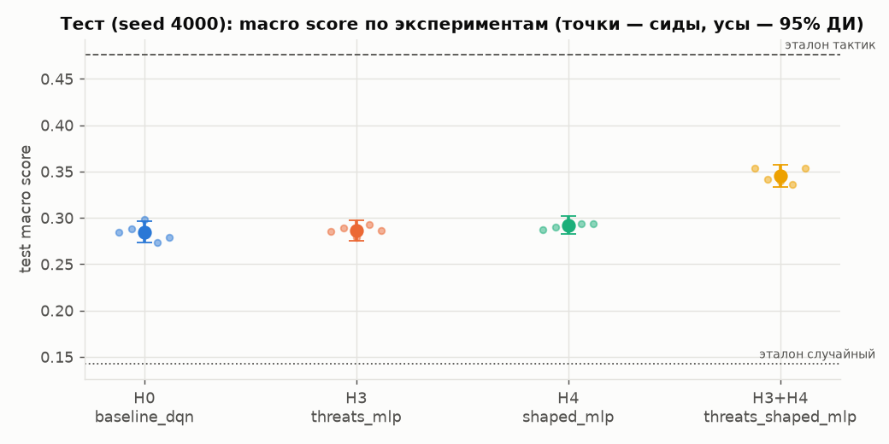
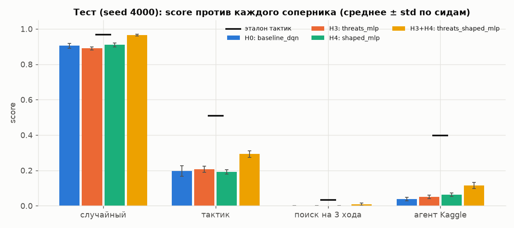
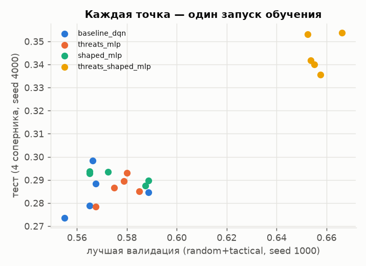
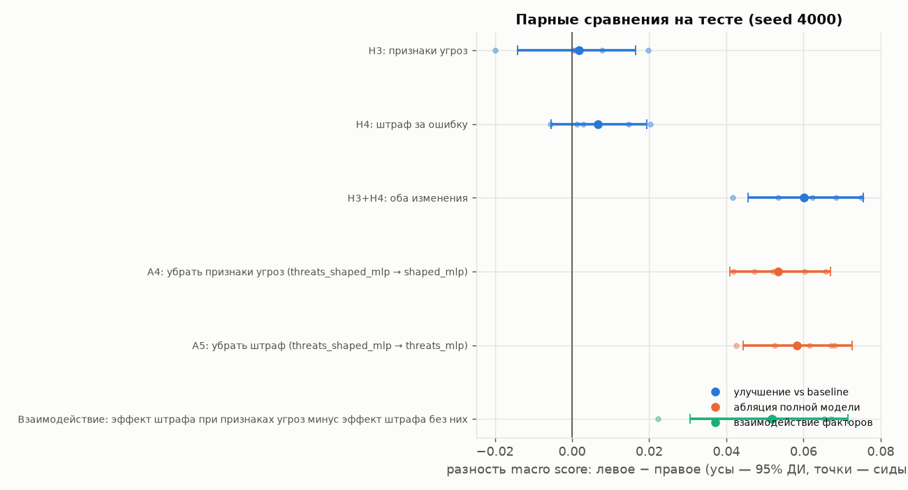
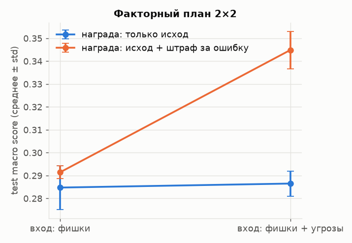
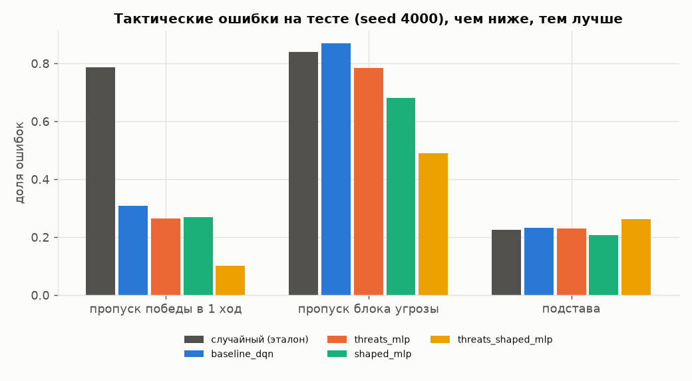
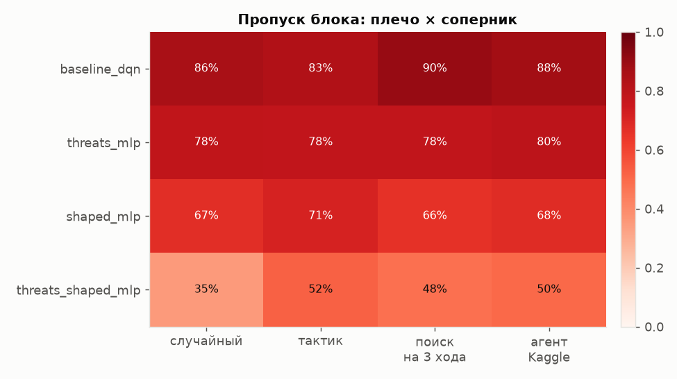
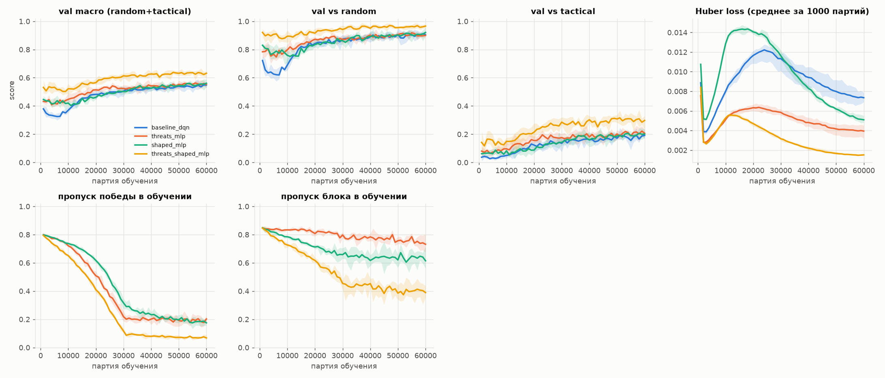

# ДЗ2: отчёт по экспериментам, абляциям и честному сравнению

Отчёт собран автоматически командой `python -m connectx_rl.hw2 --stage report` из сохранённых партий. Метрика та же, что в ДЗ1: 1 очко за победу, 0,5 за ничью, 0 за поражение, среднее по четырём соперникам (macro score). Тест ДЗ2: seed 4000, 400 партий с каждым соперником, 2 случайных первых хода, половина партий первым ходом. Знак ± обозначает стандартное отклонение по запускам обучения, в квадратных скобках 95% доверительный интервал (перекрёстный бутстреп по запускам и партиям, 2000 повторений).

## Гипотезы

- **H0 (baseline_dqn)** — Baseline ДЗ1: MLP 2×256, вход 2 плоскости, награда только за исход. Изменение: нет (точка отсчёта). Точка отсчёта. Ожидаем ~0,29 на новом тесте, как на тестах ДЗ1 (0,293) и раунда 1 (0,285).
- **H3 (threats_mlp)** — H3: признаки угроз на входе сети. Изменение: model.features: plain → threats (вход 2×6×7 → 4×6×7: + клетки немедленной победы своей и соперника). Baseline пропускает 28% побед в один ход и 86% блоков, а свёрточная сеть при том же числе параметров (H2) этого не изменила: сети не хватает не способа смотреть на доску, а сигнала, чтобы выучить 69 узоров. Мы считаем, что если дать узор готовым признаком (две плоскости: где достраивает четвёрку ходящий, где соперник), сети останется лишь связать признак с ценностью, поэтому пробуем те же MLP, соперника и бюджет с четырьмя входными плоскостями. Ожидание: рост macro score, снижение доли пропущенных побед и пропущенных блоков.
- **H4 (shaped_mlp)** — H4: штраф за тактическую ошибку в награде. Изменение: train.shaping: {} → {missed_win: 0.5, missed_block: 0.5} (−0,5 к награде перехода за пропущенную победу или незакрытую угрозу). В раунде 1 защита улучшалась только у плеч, где соперник (тактик) наказывал каждую незакрытую угрозу, но ценой умения добивать random. Мы считаем, что наказывать ошибку должен сигнал обучения, а не соперник: тогда соперник может остаться random (нападение сохраняется), а защита всё равно выучится. Поэтому пробуем штраф −0,5 за пропущенную победу и за незакрытую угрозу. Ожидание: рост macro score и снижение доли пропущенных блоков при сохранении игры против random.
- **H3+H4 (threats_shaped_mlp)** — H3+H4: признаки угроз и штраф за ошибку. Изменение: оба изменения сразу. Признаки говорят сети, где угроза, штраф говорит, что её нельзя пропускать. Мы считаем, что изменения дополняют друг друга (признак без штрафа может остаться невостребованным, штраф без признака требует выучить узор), поэтому ожидаем, что полная модель не хуже лучшего одиночного улучшения, а взаимодействие положительное.

## Таблица экспериментов

| Эксперимент | Гипотеза | Что изменено относительно baseline | Сиды | Параметров | Val (лучшая, среднее) | **Test macro** ± std | 95% ДИ | Время обучения, мин/сид | Шагов SGD, тыс. |
|---|---|---|---|---:|---:|---:|---:|---:|---:|
| `baseline_dqn` | Baseline ДЗ1: MLP 2×256, вход 2 плоскости, награда только за исход | нет (точка отсчёта) | 0 1 2 3 4 | 89 351 | 0,569 | **0,285 ± 0,010** | [0,273; 0,297] | 10,8 | 350 |
| `threats_mlp` | H3: признаки угроз на входе сети | model.features: plain → threats (вход 2×6×7 → 4×6×7: + клетки немедленной победы своей и соперника) | 0 1 2 3 4 | 110 855 | 0,577 | **0,287 ± 0,005** | [0,276; 0,297] | 123,8 | 335 |
| `shaped_mlp` | H4: штраф за тактическую ошибку в награде | train.shaping: {} → {missed_win: 0.5, missed_block: 0.5} (−0,5 к награде перехода за пропущенную победу или незакрытую угрозу) | 0 1 2 3 4 | 89 351 | 0,576 | **0,291 ± 0,003** | [0,282; 0,302] | 123,9 | 384 |
| `threats_shaped_mlp` | H3+H4: признаки угроз и штраф за ошибку | оба изменения сразу | 0 1 2 3 4 | 110 855 | 0,657 | **0,345 ± 0,008** | [0,334; 0,357] | 123,9 | 337 |

Время обучения настенное: оно зависит от числа одновременно запущенных процессов и простоя машины, поэтому сравнивать плечи по нему нельзя. Стоимость одного шага SGD измерена отдельно: у CNN она примерно в 9 раз выше, чем у MLP.

Полная версия с конфигом каждого плеча: [experiments.csv](experiments.csv). Каждый запуск отдельно (сид, эпизод лучшего чекпойнта, валидация, тест, ошибки, число шагов): [runs.csv](runs.csv). Все партии теста (исход, длина, ходы): [games.csv](games.csv).

## Тест: результат против каждого соперника

| Агент | случайный | тактик | поиск на 3 хода | агент Kaggle | **Среднее** |
|---|---:|---:|---:|---:|---:|
| случайный (эталон) | 0,494 | 0,039 | 0,000 | 0,037 | 0,142 [0,129; 0,156] |
| тактик (эталон) | 0,966 | 0,510 | 0,033 | 0,396 | 0,476 [0,460; 0,494] |
| поиск на 3 хода (эталон) | 1,000 | 0,959 | 0,477 | 0,958 | 0,848 [0,835; 0,862] |
| **`baseline_dqn`** | 0,904 ± 0,015 | 0,197 ± 0,030 | 0,001 ± 0,001 | 0,037 ± 0,010 | **0,285 ± 0,010** [0,273; 0,297] |
| **`threats_mlp`** | 0,889 ± 0,009 | 0,207 ± 0,017 | 0,000 ± 0,000 | 0,049 ± 0,010 | **0,287 ± 0,005** [0,276; 0,297] |
| **`shaped_mlp`** | 0,910 ± 0,012 | 0,192 ± 0,012 | 0,001 ± 0,001 | 0,063 ± 0,010 | **0,291 ± 0,003** [0,282; 0,302] |
| **`threats_shaped_mlp`** | 0,965 ± 0,006 | 0,293 ± 0,019 | 0,008 ± 0,008 | 0,114 ± 0,017 | **0,345 ± 0,008** [0,334; 0,357] |





## Результаты по запускам

| Эксперимент | Сид | Эпизод лучшего чекпойнта | Val | Test macro | случайный | тактик | поиск на 3 хода | агент Kaggle | Пропуск блока | Пропуск победы | Обучение, с |
|---|---:|---:|---:|---:|---:|---:|---:|---:|---:|---:|---:|
| `baseline_dqn` | 0 | 57 000 | 0,589 | 0,285 | 0,882 | 0,206 | 0,003 | 0,048 | 87,1% | 33,1% | 668 |
| `baseline_dqn` | 1 | 51 000 | 0,568 | 0,288 | 0,905 | 0,203 | 0,000 | 0,046 | 88,0% | 35,4% | 647 |
| `baseline_dqn` | 2 | 60 000 | 0,566 | 0,298 | 0,922 | 0,234 | 0,000 | 0,037 | 85,6% | 28,4% | 636 |
| `baseline_dqn` | 3 | 49 000 | 0,555 | 0,273 | 0,910 | 0,152 | 0,000 | 0,031 | 85,7% | 32,6% | 633 |
| `baseline_dqn` | 4 | 51 000 | 0,565 | 0,279 | 0,902 | 0,188 | 0,000 | 0,025 | 88,5% | 23,3% | 649 |
| `threats_mlp` | 0 | 39 000 | 0,585 | 0,285 | 0,877 | 0,217 | 0,000 | 0,045 | 81,6% | 25,4% | 7425 |
| `threats_mlp` | 1 | 56 000 | 0,579 | 0,289 | 0,900 | 0,193 | 0,000 | 0,065 | 78,4% | 27,3% | 7417 |
| `threats_mlp` | 2 | 53 000 | 0,568 | 0,278 | 0,885 | 0,185 | 0,000 | 0,044 | 76,6% | 26,8% | 7429 |
| `threats_mlp` | 3 | 56 000 | 0,580 | 0,293 | 0,895 | 0,225 | 0,000 | 0,052 | 78,3% | 26,0% | 7436 |
| `threats_mlp` | 4 | 57 000 | 0,575 | 0,287 | 0,890 | 0,216 | 0,000 | 0,040 | 77,8% | 26,7% | 7426 |
| `shaped_mlp` | 0 | 60 000 | 0,587 | 0,287 | 0,922 | 0,175 | 0,000 | 0,052 | 69,7% | 28,4% | 7442 |
| `shaped_mlp` | 1 | 59 000 | 0,589 | 0,290 | 0,902 | 0,184 | 0,000 | 0,072 | 65,7% | 26,2% | 7437 |
| `shaped_mlp` | 2 | 53 000 | 0,565 | 0,293 | 0,920 | 0,198 | 0,000 | 0,054 | 69,3% | 26,4% | 7440 |
| `shaped_mlp` | 3 | 59 000 | 0,565 | 0,294 | 0,895 | 0,205 | 0,003 | 0,072 | 67,0% | 28,8% | 7427 |
| `shaped_mlp` | 4 | 47 000 | 0,573 | 0,293 | 0,910 | 0,199 | 0,000 | 0,065 | 68,7% | 25,1% | 7438 |
| `threats_shaped_mlp` | 0 | 48 000 | 0,652 | 0,353 | 0,968 | 0,289 | 0,013 | 0,144 | 46,9% | 11,3% | 7440 |
| `threats_shaped_mlp` | 1 | 47 000 | 0,654 | 0,342 | 0,970 | 0,290 | 0,000 | 0,107 | 54,5% | 9,3% | 7434 |
| `threats_shaped_mlp` | 2 | 42 000 | 0,655 | 0,340 | 0,960 | 0,280 | 0,007 | 0,113 | 49,3% | 9,4% | 7431 |
| `threats_shaped_mlp` | 3 | 39 000 | 0,657 | 0,336 | 0,958 | 0,280 | 0,000 | 0,105 | 47,4% | 11,2% | 7436 |
| `threats_shaped_mlp` | 4 | 58 000 | 0,666 | 0,354 | 0,970 | 0,325 | 0,018 | 0,102 | 46,8% | 9,7% | 7426 |



## Парные сравнения: улучшения и абляции

Все плечи сыграли одни и те же тестовые партии (одинаковые дебюты и случайность соперника), пары строятся по партии и по номеру сида. Разность положительна, если левое плечо сильнее. Критерий из ДЗ1: нижняя граница 95% ДИ больше нуля и соответствующий тип ошибок стал реже.

| Сравнение | Левое − правое | Разность | 95% ДИ | По сидам | Ошибка: было → стало | Вердикт |
|---|---|---:|---:|---|---|---|
| H3: признаки угроз | `threats_mlp` − `baseline_dqn` | +0,002 | [−0,014; +0,016] | +0,000, +0,001, −0,020, +0,020, +0,008 | пропуск победы в 1 ход: 30,8% → 26,4% | ○ шум: ДИ включает 0 |
| H4: штраф за ошибку | `shaped_mlp` − `baseline_dqn` | +0,007 | [−0,005; +0,019] | +0,003, +0,001, −0,006, +0,020, +0,015 | пропуск блока угрозы: 87,0% → 68,0% | ○ шум: ДИ включает 0 |
| H3+H4: оба изменения | `threats_shaped_mlp` − `baseline_dqn` | +0,060 | [+0,046; +0,075] | +0,068, +0,053, +0,042, +0,062, +0,075 | — | ✔ ДИ > 0 |
| A4: убрать признаки угроз (threats_shaped_mlp → shaped_mlp) | `threats_shaped_mlp` − `shaped_mlp` | +0,053 | [+0,041; +0,067] | +0,066, +0,052, +0,047, +0,042, +0,060 | — | ✔ ДИ > 0 |
| A5: убрать штраф (threats_shaped_mlp → threats_mlp) | `threats_shaped_mlp` − `threats_mlp` | +0,058 | [+0,044; +0,073] | +0,068, +0,052, +0,062, +0,043, +0,067 | — | ✔ ДИ > 0 |
| Взаимодействие: эффект штрафа при признаках угроз минус эффект штрафа без них | (a+b) − a − b + 0 | +0,052 | [+0,031; +0,072] | +0,065, +0,051, +0,067, +0,022, +0,053 | — | ✔ взаимодействие есть |





## Тактические ошибки

Доля считается от числа позиций, где такая ошибка была возможна (микро-усреднение по всем сидам и соперникам).

| Агент | пропуск победы в 1 ход | пропуск блока угрозы | подстава |
|---|---:|---:|---:|
| случайный (эталон) | 78,8% | 84,0% | 22,4% |
| тактик (эталон) | 0,0% | 0,0% | 0,0% |
| поиск на 3 хода (эталон) | 0,0% | 3,7% | 0,0% |
| **`baseline_dqn`** | 30,8% | 87,0% | 23,1% |
| **`threats_mlp`** | 26,4% | 78,5% | 23,0% |
| **`shaped_mlp`** | 27,0% | 68,0% | 20,7% |
| **`threats_shaped_mlp`** | 10,2% | 48,9% | 26,2% |



Пропуск блока по соперникам (строка — эксперимент):

| Эксперимент | случайный | тактик | поиск на 3 хода | агент Kaggle |
|---|---:|---:|---:|---:|
| `baseline_dqn` | 85,9% | 83,3% | 90,0% | 87,8% |
| `threats_mlp` | 78,3% | 77,8% | 77,9% | 79,7% |
| `shaped_mlp` | 67,2% | 71,2% | 65,7% | 68,0% |
| `threats_shaped_mlp` | 34,8% | 52,2% | 48,0% | 50,2% |



## Сторона и длина партии

| Эксперимент | Соперник | Первым | Вторым | Средняя длина, ходов |
|---|---|---:|---:|---:|
| `baseline_dqn` | случайный | 0,952 | 0,857 | 11,1 |
| `baseline_dqn` | тактик | 0,271 | 0,122 | 17,3 |
| `baseline_dqn` | поиск на 3 хода | 0,001 | 0,000 | 13,0 |
| `baseline_dqn` | агент Kaggle | 0,051 | 0,025 | 17,3 |
| `threats_mlp` | случайный | 0,957 | 0,822 | 11,0 |
| `threats_mlp` | тактик | 0,273 | 0,142 | 16,9 |
| `threats_mlp` | поиск на 3 хода | 0,000 | 0,000 | 13,0 |
| `threats_mlp` | агент Kaggle | 0,068 | 0,030 | 18,0 |
| `shaped_mlp` | случайный | 0,940 | 0,880 | 12,0 |
| `shaped_mlp` | тактик | 0,251 | 0,134 | 18,8 |
| `shaped_mlp` | поиск на 3 хода | 0,000 | 0,001 | 14,4 |
| `shaped_mlp` | агент Kaggle | 0,070 | 0,057 | 20,7 |
| `threats_shaped_mlp` | случайный | 0,984 | 0,946 | 10,8 |
| `threats_shaped_mlp` | тактик | 0,382 | 0,204 | 19,5 |
| `threats_shaped_mlp` | поиск на 3 хода | 0,015 | 0,000 | 14,9 |
| `threats_shaped_mlp` | агент Kaggle | 0,128 | 0,100 | 22,8 |

## Кривые обучения

Среднее по сидам, полоса — минимум и максимум. Валидация одинакова для всех плеч: 200 партий против random и 200 против tactical, seed 1000. Доля побед в обучении у плеч со смесью соперников считается против смеси, поэтому с baseline напрямую не сравнима.



## Примеры ошибок

Столбцы 0–6 слева направо, точка — пустая клетка.

### Лучшее плечо: `threats_shaped_mlp`

**Пропущенная победа.** Соперник «случайный», партия 1.
```
O . . O . . .
X . . X . X .
X . . O . X .
O . O O . X .
O X O X . O .
X X X O X O .
0 1 2 3 4 5 6
  * ^
Агент играет O. Знак ^ показывает ход агента, знак * показывает правильные ходы.
```

**Пропущенный блок.** Соперник «случайный», партия 1.
```
O . . O . . .
X . . X . X .
X . . O . X .
O . . O . X .
O . O X . O .
X X X O X O .
0 1 2 3 4 5 6
    ^     *
Агент играет O. Знак ^ показывает ход агента, знак * показывает правильные ходы.
```

**Подстава.** Соперник «случайный», партия 1.
```
. . . . . . .
. . . . . . .
. . . X . X .
. . . O . X .
X O . X . O .
X O X O X O O
0 1 2 3 4 5 6
* * * * ^ * *
Агент играет O. Знак ^ показывает ход агента, знак * показывает правильные ходы.
```

### Новые плечи: ошибка, которая стала чаще всего

Для каждого плеча показана ошибка, доля которой выросла сильнее всего относительно `baseline_dqn`. Это разбор того, что именно сломалось.

`threats_mlp`: ни один тип ошибок не стал чаще, чем у `baseline_dqn`.

`shaped_mlp`: ни один тип ошибок не стал чаще, чем у `baseline_dqn`.

`threats_shaped_mlp`: подстава 23,1% → 26,2%.

**Подстава.** Соперник «случайный», партия 1.
```
. . . . . . .
. . . . . . .
. . . X . X .
. . . O . X .
X O . X . O .
X O X O X O O
0 1 2 3 4 5 6
* * * * ^ * *
Агент играет O. Знак ^ показывает ход агента, знак * показывает правильные ходы.
```

## Автоматические проверки честности

- Конфиг валидации одинаков у всех плеч: **да** (seed 1000).
- Конфиг теста одинаков у всех оценок: **да** (seed 4000; тест ДЗ1 имел seed 2000, валидация seed 1000).
- Ключи `train`, одинаковые у всех плеч: `opponents`, `episodes`, `gamma`, `lr`, `batch_size`, `buffer_size`, `warmup_transitions`, `train_every`, `target_update_every`, `double_dqn`, `target_clip`, `grad_clip`, `eps_start`, `eps_end`, `eps_decay_episodes`, `log_every`, `val_every`.
- Ключи `train`, различающиеся между плечами: `shaping`.
- best.pt = максимум val_macro по истории обучения (проверено для каждого сида).
- Одни и те же партии у всех плеч (ID, сторона, дебют): проверено функцией `check_pairing`.
- SHA-256 всех оценённых чекпойнтов записаны в [summary.json](summary.json).

